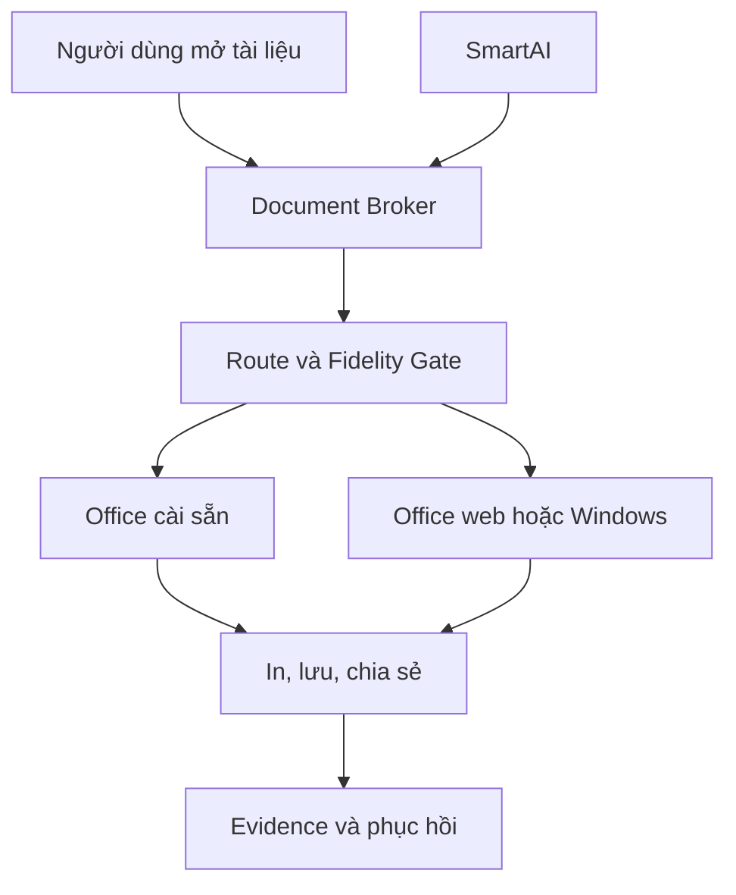

# NaMiOS — Phụ lục 07: Bộ Office tích hợp sẵn và chương trình chứng nhận thiết bị

**Ngày:** 06/11/2026  
**Chủ dự án:** Đỗ Chí Cường và Đỗ Bảo Nam  
**Quyết định đã chốt:** bộ Office là **ứng dụng riêng, cài sẵn trong NaMiOS, tích hợp sâu với File Manager và SmartAI**. Giai đoạn đầu dùng nền mã nguồn mở; đánh giá LibreOffice như ứng viên tham chiếu, lựa chọn phiên bản/chiến lược đóng gói sau một bước đánh giá kỹ thuật và giấy phép. Không viết lại Word/Excel/PowerPoint từ đầu ở mốc đầu tiên.  
**Tính chất:** đặc tả bổ sung độc lập, mã mới **ODC-001–ODC-048**; tiếp nối ECO, COMP, SAI, SYS và PRA. Claude Code chỉ cần đọc file này cùng `docs/STATUS.md`, ADR và hợp đồng code liên quan.

## 1. Vì sao kiến trúc này phù hợp

Người dùng cần mở, sửa, chia sẻ và in đúng các tài liệu của họ, kể cả khi mạng yếu hoặc không có tài khoản Microsoft. Một bộ Office cài sẵn đáp ứng công việc cơ bản ngay khi khởi động, còn việc tách nó khỏi lõi NaMiOS cho phép cập nhật bộ lọc tài liệu, sửa giao diện và vá lỗi mà không buộc phát hành lại hệ điều hành.

LibreOffice có mã nguồn, SDK/UNO để làm tiện ích mở rộng và bộ lọc [1]. Đây là **ứng viên để thẩm định**, chưa mặc định là sản phẩm mang thương hiệu NaMiOS. Kiểm tra giấy phép, nguồn gói, tên gọi, logo, nghĩa vụ công bố mã nguồn và hỗ trợ trước khi phân phối bản sửa đổi. Tài liệu của LibreOffice ghi giấy phép thành phần và quyền thương hiệu là những vấn đề riêng [2].

Microsoft Office desktop chỉ công bố cài đặt trên Windows/macOS; Word/Excel web có giới hạn riêng, trong đó VBA không chạy trong Excel web [3]. Vì vậy danh mục của NaMiOS phải phân biệt bộ Office cài sẵn, Office web chính thức, bản desktop qua Windows được cấp phép và thử nghiệm Wine theo từng bản. Không dùng tên “Microsoft Office” cho bộ ứng dụng do NaMiOS đóng gói.

### 1.1 Sơ đồ tích hợp

Document Broker và Fidelity Gate là code xác định được. SmartAI giải thích, hỏi thêm khi cần và hỗ trợ chọn đường. Một tài liệu không thể bị AI tự upload, sửa đổi hoặc đổi ứng dụng mặc định vì chỉ dẫn nằm trong nội dung tài liệu.

## 2. Bộ Office tách gói và tích hợp sâu

**ODC-001 P0 — Ranh giới gói.** Office đóng gói như ứng dụng độc lập, có version, kênh cập nhật, thư mục dữ liệu, dependency, giấy phép và rollback riêng. Bản cài mặc định trong ISO nhưng có thể cập nhật mà không cập nhật kernel/desktop. **Nghiệm thu:** nâng Office rồi rollback vẫn mở được tài liệu tạo trước; NaMiOS vẫn boot khi Office lỗi.

**ODC-002 P0 — Đánh giá engine nền.** Làm một ADR so sánh ứng viên mã nguồn mở theo: độ đúng DOCX/XLSX/PPTX, tiếng Việt/font, in, API mở rộng, tài nguyên máy, bảo trì, giấy phép và khả năng tùy biến UX. Với LibreOffice, thử bản từ kho phân phối và SDK/UNO trước khi quyết định cần fork hay không. **Nghiệm thu:** ADR có ít nhất 15 fixture tài liệu và số đo; không chọn engine chỉ từ quảng cáo.

**ODC-003 P0 — Chiến lược tùy biến.** Giai đoạn A: đóng gói upstream, thiết lập tiếng Việt, templates và tích hợp hệ thống. Giai đoạn B: tiện ích mở rộng/bộ lọc khi SDK cho phép. Giai đoạn C: sửa core hoặc fork chỉ khi có blocker lặp lại, quyền triển khai rõ, chủ trì bảo trì và bài regression. **Nghiệm thu:** từng sửa đổi ghi rõ upstream/downstream, test và kế hoạch cập nhật khi upstream ra bản mới.

**ODC-004 P0 — Tên và thương hiệu.** Có thể đặt tên sản phẩm riêng sau kiểm tra pháp lý và tài sản thương hiệu; giao diện phải nêu engine/giấy phép nguồn khi yêu cầu. Không dùng logo/tên của nhà cung cấp như chứng nhận hợp tác khi chưa được phép. **Nghiệm thu:** kiểm kê notices, licenses, mã nguồn sửa đổi và điều kiện phân phối trong package.

**ODC-005 P0 — Mô đun người dùng.** Ít nhất xử lý văn bản, bảng tính, trình chiếu, xem PDF và mẫu biểu. PDF editing, database hay macro riêng là scope riêng, không nói “có đủ Microsoft Office” chỉ vì có ba icon. **Nghiệm thu:** mỗi module có chức năng đã thử và giới hạn được hiển thị.

**ODC-006 P0 — Định dạng mặc định.** Cho chọn ODF hoặc OOXML theo policy tổ chức và workflow; nhắc trước khi dùng tính năng có thể mất dữ liệu khi lưu sang định dạng khác. Không tự chuyển đổi tệp đến từ Word/Excel rồi ghi đè bản gốc. **Nghiệm thu:** Save As và Export có preview khác biệt, bản gốc có thể khôi phục.

**ODC-007 P0 — Document Broker.** File Manager, tìm kiếm, menu Open With và SmartAI gọi chung API `inspect_document → explain_routes → open_copy/open_original → verify_save`. Metadata gồm định dạng, macro, chữ ký, mã hóa/IRM, font thiếu, external links, nguồn file, độ nhạy và app/version được đề xuất. Phân tích metadata được giới hạn và an toàn với file độc hại. **Nghiệm thu:** DOCX bình thường và XLSM cần VBA chọn route khác, không mở tài liệu nhạy cảm trên web mặc định.

**ODC-008 P0 — Office Route Matrix.** Các mode `bundled_office`, `official_web`, `tested_wine`, `licensed_windows_remote`, `licensed_windows_vm`, `read_only_viewer`; có `required_features`, license, mạng, local/cloud location, fidelity evidence, version và hạn chế. “Mở được” tách khỏi “sửa đúng”, “in đúng” và “chạy macro”. **Nghiệm thu:** file có add-in COM không được route sang bundled Office với nhãn tương thích đầy đủ.

**ODC-009 P0 — Giao diện quen thuộc.** Giao diện có File, Home, Insert, Layout, Review, View theo nhiệm vụ, thanh công cụ tìm lệnh, vùng Recent, pin mẫu thường dùng, autosave indicator và Print Preview; mượn cách tổ chức công việc quen thuộc, tự thiết kế component/logo và không sao chép giao diện Microsoft. **Nghiệm thu:** 10 người dùng Windows pilot tự tìm mở, lưu, định dạng, lọc dữ liệu, in và xuất PDF; ghi thời gian/sai thao tác.

**ODC-010 P0 — Tiếng Việt chuyên nghiệp.** Bộ gõ Telex/VNI, kiểm dấu, Unicode, tìm kiếm có/không dấu, số tiền/ngày, dấu phân cách và văn phong hành chính. Không tự sửa nội dung pháp lý hoặc số liệu khi chỉ mở file. **Nghiệm thu:** bộ mẫu gồm tên người, địa danh, điều khoản, bảng điểm, số tiền và ngày được đọc/ghi/in đúng.

**ODC-011 P1 — Bộ mẫu Việt Nam.** Mẫu công văn, biên bản, tờ trình, hợp đồng đơn giản, phiếu thu, bảng điểm, giáo án và báo cáo doanh nghiệp, có version/source/chủ sở hữu, phông/lề được người nghiệp vụ duyệt. Template chỉ là khởi điểm, không được nói là mẫu bắt buộc của cơ quan nếu chưa xác minh. **Nghiệm thu:** mỗi mẫu có dữ liệu giả, in PDF/A4 đúng, chỉnh sửa dễ và kiểm bản quyền.

**ODC-012 P0 — In từ Office đến máy thật.** Từ Writer/Calc/Impress hoặc engine đã chọn tới CUPS, preview A4/A5, scale, lề, duplex, số trang, header/footer, QR/barcode; xác nhận bản giấy với mẫu Windows khi công việc yêu cầu. **Nghiệm thu:** bảng tính rộng không cắt cột tiền; văn bản nhiều trang không mất trang/cuối dòng.

**ODC-013 P1 — Tệp và cộng tác.** Mở/lưu từ thư mục cục bộ, ổ SMB, thư mục đồng bộ được đơn vị cho phép; kiểm khóa tệp, conflict, autosave/recovery và quyền. Office web dùng tài khoản và quyền của nhà cung cấp, NaMiOS chỉ hiển thị ranh giới dữ liệu. **Nghiệm thu:** hai người cùng sửa bản thử không ghi đè âm thầm, mất VPN có bản phục hồi.

**ODC-014 P0 — Bộ lọc tài liệu có bằng chứng.** Test vòng mở → sửa → lưu → mở lại trong engine và trên Windows đối chứng; so semantic và render, gồm công thức, pivot, chart, conditional formatting, merged cells, footnotes, table of contents, track changes, chữ ký và external links. **Nghiệm thu:** sai công thức/số tiền hoặc chữ ký mất hiệu lực là fail, dù file mở được.

**ODC-015 P0 — Macro và tự động hóa.** Phân loại VBA/ActiveX/COM add-ins, macro của engine nền và script tổ chức. Không thực thi macro không tin cậy; không tuyên bố chuyển VBA sang ngôn ngữ khác là tương đương nếu chưa kiểm hành vi. Nếu workflow cần macro/COM, chọn Windows đã cấp phép hoặc hợp tác port với chủ mã. **Nghiệm thu:** XLSM chứa macro vẫn giữ bản gốc và cảnh báo; chạy web không gắn nhãn macro pass.

**ODC-016 P1 — Font và bố cục.** Kiểm font trong file, font sẵn có và bản quyền; đo thay thế font theo chữ Việt và layout trang, cung cấp preview trước in/gửi. Không đóng gói font thương mại của Windows khi chưa có quyền. **Nghiệm thu:** tài liệu có font thiếu không tự lưu lại với thay thế mà không cảnh báo.

**ODC-017 P0 — Chính sách tệp nhạy cảm.** Quyền file và nội dung theo SAI; AI metadata-only mặc định, không gửi văn bản hợp đồng/bảng lương lên model ngoài hoặc Office web khi chưa có quyền rõ. **Nghiệm thu:** file mẫu chứa CCCD/mật khẩu giả không xuất hiện trong log, telemetry, prompt ngoài hay lịch sử tìm kiếm công khai.

**ODC-018 P1 — SmartAI trong Office.** Lệnh “tóm tắt”, “giải thích công thức”, “soát lỗi chính tả”, “định dạng công văn”, “tạo dàn ý” cần hiển thị phạm vi file/đoạn, preview diff, nguồn/độ chắc chắn, chấp nhận hoặc hoàn tác. AI không tự làm thay đổi nội dung hoặc công thức bảng lương khi người dùng chỉ hỏi. **Nghiệm thu:** AI đề xuất sửa công thức sai không qua kiểm tra số liệu, không có nút “áp dụng tự động” cho vùng nhạy cảm.

**ODC-019 P1 — So sánh bản Office.** Trước khi chuyển workflow quan trọng, hiển thị khác biệt giữa file tạo ở NaMiOS và Windows đối chứng ở từng phần có nghĩa, không chỉ hình ảnh tổng quát; ưu tiên bảng tính kế toán và mẫu hành chính. **Nghiệm thu:** bộ fixture cố ý thay 1 chữ số, 1 ngắt trang, 1 macro, 1 link ngoài đều được phát hiện hoặc hiển thị giới hạn.

**ODC-020 P0 — Tách lifecycle.** Office, bộ mẫu, extension, font, model AI và OS mỗi thứ có version, nguồn, ring lab/pilot/stable và rollback riêng; khi một bản Office đổi bộ lọc, chỉ workflow tài liệu liên quan chuyển `needs_retest`. **Nghiệm thu:** cập nhật Office không làm rớt kết nối Wi‑Fi; recipe Office cũ có thể quay lại.

## 3. Chương trình chứng nhận thiết bị: mục tiêu “hầu hết”

Mục tiêu độ phủ phải được định nghĩa theo **số người dùng và model thực tế**, không theo “mọi chuẩn”. Thước đo: `coverage_user_weighted = số người dùng pilot có đủ workflow thiết bị bắt buộc / tổng người dùng pilot`. Báo riêng tỷ lệ model đã thử, tỷ lệ tính năng pass và tỷ lệ fallback. Không công bố một phần trăm toàn thị trường nếu chưa có mẫu đại diện.

**ODC-021 P0 — Inventory có trọng số.** Khảo sát trường học, hộ kinh doanh, văn phòng và đơn vị hành chính: model máy, firmware, USB VID/PID khi có, nơi kết nối, số người dùng, số bản in/tháng nếu đơn vị có dữ liệu, tần suất scan/copy, hotspot và thiết bị Bluetooth bắt buộc. **Nghiệm thu:** top 20 model/đường kết nối pilot có số lượng và owner xác nhận; không tạo số giả.

**ODC-022 P0 — Capability per function.** Mỗi model có các trục `print/scan/copy_via_pc/copy_on_device/fax/duplex/ADF/secure_release/USB/network`; mỗi trục có version và evidence, không suy từ model cùng hãng. **Nghiệm thu:** máy scan pass, in fail vẫn hiện rõ từng chức năng.

**ODC-023 P0 — Discovery và onboarding.** Device Hub tìm USB, IPP/mDNS, IP qua nhập tay, SMB print queue, Bluetooth printer nếu thực hỗ trợ; hiện tên dễ nhận biết, vị trí, model, quyền, backend và chức năng. Nếu mDNS/VLAN bị chặn có đường thêm IP/IT, không thử quét mạng rộng ngoài quyền. **Nghiệm thu:** một máy USB và một máy mạng cùng model không bị hợp nhất sai hay xuất hiện trùng không giải thích.

**ODC-024 P0 — Đường in hiện đại.** Dùng driverless IPP/AirPrint/Mopria, IPP-over-USB khi tương thích; chọn backend từ capability, không từ tên hãng. OpenPrinting mô tả driverless và cầu nối cho máy cũ [4]. **Nghiệm thu:** in A4 hai mặt, nhiều bản, PDF/ảnh/Unicode và kiểm bản giấy trên model pilot.

**ODC-025 P1 — Đường máy cũ.** Với máy không driverless, xem xét Printer Application hoặc driver Linux được vendor/distro cho phép; công bố bất kỳ chức năng chưa có như khay, stapling, secure print. Thiết bị chỉ có driver kernel Windows là blocker cho Linux. **Nghiệm thu:** một model cũ chạy theo đường hợp lệ, máy khác thiếu vendor support được ghi blocked.

**ODC-026 P0 — Scan và photo.** eSCL/WSD/SANE/vendor backend theo model, ADF, scan hai mặt và xử lý kẹt giấy; nếu thiết bị có copy trực tiếp trên máy thì NaMiOS chỉ hướng dẫn/điều khiển khi có API chính thức. Workflow Scan → Print của NaMiOS hiển thị là chức năng riêng. **Nghiệm thu:** 20 trang ADF với một lần kẹt vẫn biết chính xác trang đã hoàn thành.

**ODC-027 P0 — USB an toàn.** Phân biệt flash/ổ cứng, máy in, camera, token, điện thoại MTP, barcode, serial/HID; tự mount thiết bị lưu trữ theo quyền, chặn tự chạy `.exe`, hiện trạng thái/cấp nguồn/lỗi. **Nghiệm thu:** rút khi đang copy có trạng thái lỗi và không gọi file dở là hoàn chỉnh.

**ODC-028 P0 — Card mạng dây.** Test chipset/driver/firmware, DHCP, DNS, IPv4/IPv6, 100/1000/2.5G nếu phần cứng hỗ trợ, 802.1X/VLAN theo policy, sleep/resume và dock USB-C; chuẩn tính năng theo tổ chức. **Nghiệm thu:** 3 adapter pilot có kết quả từng tính năng, rút dây giữa giao dịch không gửi lại.

**ODC-029 P0 — Wi‑Fi.** Dùng NetworkManager và backend phù hợp; ma trận WPA2/WPA3 Personal, Enterprise EAP được đơn vị dùng, captive portal, dual-band/6 GHz khi card/firmware/quy định tần số cho phép, roaming, hotspot, power save. NetworkManager cung cấp các phương thức nhưng mỗi adapter và network thực cần test [5]. **Nghiệm thu:** home/office/guest test; phân biệt lỗi mật khẩu, IP, DNS và trang đăng nhập.

**ODC-030 P0 — Bluetooth theo profile.** Dùng BlueZ và audio stack hệ thống; test Classic/LE, HID, A2DP, HFP, GATT/OBEX nếu có trường hợp sử dụng, pairing, reconnect, pin, sleep/resume. “Bluetooth mọi chuẩn” không thể gắn badge chung vì stack, chipset, profile và thiết bị đầu cuối khác nhau [6]. **Nghiệm thu:** chuột, bàn phím, tai nghe mic, loa và điện thoại pilot báo riêng chức năng nào đạt.

**ODC-031 P1 — Firmware và nguồn.** Khi chipset cần firmware, lấy từ kho/vendor có nguồn và giấy phép phù hợp, pin version; SmartAI không tự flash BIOS/firmware thiết bị. **Nghiệm thu:** thiếu firmware hiện blocker cụ thể và nguồn chính thức, không tải binary trôi nổi.

**ODC-032 P0 — Ma trận lab.** Chọn tối thiểu 3 laptop, 2 desktop, 2 MFP (một USB và một LAN), 1 máy in cũ, 2 Wi‑Fi router, 2 card mạng, 2 tai nghe và 2 bàn phím/chuột Bluetooth theo thiết bị người dùng đang có. Đây là **kế hoạch lấy mẫu**, không là kết quả đã pass. **Nghiệm thu:** có phiếu model, bản NaMiOS, chức năng, testcase, expected/actual, ảnh bản in đã che dữ liệu, tester và ngày.

**ODC-033 P0 — Recheck trigger.** Đổi kernel, firmware, CUPS/SANE/Printer Application, NetworkManager, BlueZ, audio stack, route hoặc device model phải invalid evidence theo vùng ảnh hưởng. **Nghiệm thu:** cập nhật kernel làm card Wi‑Fi pilot cần kiểm lại, không vô cớ hạ trạng thái Office file không phụ thuộc card.

**ODC-034 P1 — Hợp tác vendor.** Đề nghị tài liệu API/driver Linux, công cụ cấu hình máy photo, test device và quyền phân phối; báo cáo lỗi đã lọc dữ liệu. Mọi liên hệ do chủ dự án phân công. **Nghiệm thu:** hồ sơ vendor phân biệt yêu cầu đã gửi/được chấp thuận/chưa có phản hồi; không giả định hợp tác.

## 4. SmartAI trong quá trình chuyển máy

**ODC-035 P0 — Readiness trước cài.** AI khảo sát read-only máy Windows cũ hoặc trả form người dùng: 10 việc bắt buộc, Office file có macro/font/add-in, model thiết bị, mạng nội bộ, license app/Windows fallback; không chép tài liệu khi chưa cho phép. **Nghiệm thu:** thiếu một công việc bắt buộc trả no-go rõ với đường xử lý.

**ODC-036 P0 — Lựa chọn có giải thích.** Người dùng nói “mở bảng lương”, AI nêu route Office cài sẵn/web/Windows, vị trí dữ liệu, độ đúng đã thử, quyền cần cấp và lý do; dùng policy engine để chọn, không dựa trên tự tin lời nói. **Nghiệm thu:** XLSM có macro không được chọn web như route đã hoàn thành.

**ODC-037 P0 — Device Doctor.** AI nhận câu “máy photo không in được”, phân biệt in/scan/copy, kết nối mạng/USB, giấy/mực, hàng đợi, quyền và driver; tối đa ba bước hỗ trợ mỗi lượt, có lối cho IT. **Nghiệm thu:** bốn lỗi khác nhau cho nguyên nhân và hướng xử lý khác nhau, không tự reset máy dùng chung.

**ODC-038 P1 — Office Doctor.** AI kiểm metadata, phân tích file test, so bố cục/số liệu và tạo báo cáo khác biệt; không tự thay chữ ký, công thức kế toán hay ghi đè file thật. **Nghiệm thu:** sai số tiền một đồng vẫn bị nhận ra ở fixture số tiền.

**ODC-039 P0 — Offline và quyền.** Office và Device Hub vẫn hoạt động khi model AI mất mạng; mọi dữ liệu nhạy cảm lên AI ngoài máy cần consent cụ thể, nút xem trước và log đã lọc. **Nghiệm thu:** tắt provider AI, vẫn mở DOCX, in, scan và nối Wi‑Fi; prompt chứa PIN giả không được gửi.

## 5. Roadmap triển khai và tiêu chí phát hành

| Mốc | Đầu ra | Gate |
| --- | --- | --- |
| O0 — Quyết định engine | ODC-001–004, ADR ứng viên, license audit, 15 fixture Office | Chốt engine/version và mô hình package/branding; nếu chưa đạt, không đặt tên thương mại. |
| O1 — Office dùng được | ODC-005–020, broker, route, UI, templates thử, in, file fidelity | 5 workflow văn phòng của đơn vị pilot đúng dữ liệu/in và rollback. |
| O2 — Thiết bị phổ biến | ODC-021–034, inventory, Device Hub, lab MFP/network/Bluetooth | Model pilot đạt các chức năng bắt buộc, blocked rõ ràng, driver có nguồn. |
| O3 — SmartAI xuyên suốt | ODC-035–039, readiness, Office/Device Doctor | 10 người pilot làm được việc, AI không báo thành công sai hay làm mất dữ liệu. |
| O4 — Release | ODC-040–048, scorecard, hỗ trợ, vận hành | Go/no-go theo persona, đủ bằng chứng và kế hoạch bảo trì. |

**ODC-040 P0 — Ba persona pilot.** Giáo viên/nhân viên trường, kế toán doanh nghiệp nhỏ, nhân viên hành chính; mỗi persona liệt kê 10 workflow bắt buộc, app/version, Office file, thiết bị, mạng và người nghiệp vụ xác nhận. **Nghiệm thu:** persona thiếu một việc thiết yếu không được gắn “chuyển máy chính được”.

**ODC-041 P0 — Chuẩn đầu ra.** Mỗi test office/device có expected, actual, môi trường, hash fixture, bản giấy/file, người duyệt nghiệp vụ, pass/partial/blocked và ranh giới. **Nghiệm thu:** status có thể truy từ UI đến evidence; không suy “đã thấy thiết bị” thành “in được”.

**ODC-042 P0 — Chặn phát hành.** Dừng pilot/stable nếu mất tệp, sai tiền, mất chữ ký, in thiếu trang, lỗi dữ liệu DB, bản backup không restore hoặc SmartAI vượt quyền. Có rollback cho app Office và phần OS liên quan. **Nghiệm thu:** cố ý làm sai fixture, gate chuyển no-go.

**ODC-043 P1 — TCO và công sức bảo trì.** Báo chi phí phát triển/bảo trì Office layer, thời gian merge upstream, phí license ngoại vi/Windows fallback, support per device và tần suất cập nhật bộ lọc. Không coi OS/Office miễn phí là không có chi phí vận hành. **Nghiệm thu:** quyết định fork có dự toán nhân lực và kế hoạch 2 năm, không chỉ “làm cho đẹp”.

**ODC-044 P1 — Release note có phạm vi.** Công bố engine Office, version, giấy phép, kiểu file đã thử, tính năng chưa đạt, thiết bị model/firmware, tuyến fallback, ngày chứng nhận và người liên hệ hỗ trợ. **Nghiệm thu:** người dùng biết một file macro hoặc máy in chưa test trước khi chuyển.

**ODC-045 P1 — Thiết kế giao diện nhất quán.** Office dùng chung theme NaMiOS về font tiếng Việt, chế độ sáng/tối, quy tắc focus, biểu tượng và màn hình trợ giúp; cho người dùng chọn độ dày thanh công cụ và khổ màn hình; không fork UI quá sớm khi upstream có thể cấu hình. **Nghiệm thu:** 1366×768 và màn hình lớn, scale 125–200%, thao tác chính không bị ẩn.

**ODC-046 P1 — Hỗ trợ đa tổ chức.** Chính sách app mặc định, format mặc định, templates, extension allowlist, remote Office được cấp phép, model AI và hành vi cloud do tổ chức quản lý; người dùng cá nhân có bộ mặc định riêng. **Nghiệm thu:** policy trường không lộ template sang doanh nghiệp khác; admin không đọc tài liệu nếu không có quyền.

**ODC-047 P1 — Chương trình beta model mới.** Người dùng gửi thông tin model và log đã lọc, đội kỹ thuật mượn/mua thiết bị phổ biến để lab, thêm test, báo ngày retest; không nâng badge chỉ nhờ một bình luận “máy tôi in được”. **Nghiệm thu:** một model beta có state `reported → lab_tested → pilot_verified → published`.

**ODC-048 P0 — Chỉ số thành công.** Báo riêng `workflow coverage`, `user-weighted device coverage`, `Office fidelity pass`, `Windows dependency`, số lỗi gây mất dữ liệu và thời gian phục hồi; các mẫu số, nguồn khảo sát và ngày được công bố. **Nghiệm thu:** dashboard không lấy 100 model trong catalog làm 100 model được hỗ trợ.

## 6. Test mẫu bắt buộc

| Mã | Kịch bản | Kết quả mong đợi |
| --- | --- | --- |
| T01 | Office nâng bản rồi lỗi mở DOCX | Rollback package, bản gốc và file đã lưu không mất. |
| T02 | XLSM chứa VBA được mở ở Office cài sẵn | Có cảnh báo macro, không công bố macro pass; route Windows khi workflow cần chạy. |
| T03 | Hợp đồng thiếu font, in lệch trang | Preview cảnh báo, workflow in chưa pass. |
| T04 | Bảng điểm sửa một chữ số trong tổng | Fidelity gate fail, không overwrite. |
| T05 | Office web cần upload tệp nhạy cảm | Hiển thị đích và cần quyền; mặc định không upload. |
| T06 | Máy MFP in được, scan fail, copy tại máy được | Ba trạng thái chức năng khác nhau, không gộp “hỗ trợ hoàn toàn”. |
| T07 | Máy in mạng trong VLAN bị chặn mDNS | Add theo IP/IT theo quyền, không quét mạng rộng. |
| T08 | Máy in cũ chỉ có Windows driver | Blocker và vendor/Windows fallback; không giả nhận driver Linux. |
| T09 | Card Wi‑Fi mới thiếu firmware | Nêu firmware nguồn chính thức, không tải binary ngẫu nhiên. |
| T10 | Tai nghe BT ghép cặp nhưng mic không hoạt động | Audio profile partial, SmartAI không nói “đã kết nối đầy đủ”. |
| T11 | Rút USB flash khi đang copy | File dở không bị coi là hoàn chỉnh; gợi ý cách phục hồi. |
| T12 | SmartAI ngoại tuyến | Office, in, scan và kết nối mạng vẫn hoạt động. |
| T13 | Cập nhật kernel làm card mạng pilot fail | Chặn stable, rollback kernel, badge thiết bị `needs_retest`. |
| T14 | Người dùng gõ “mở bảng lương” | AI chọn route theo quyền/fidelity; không đọc tệp khác. |

## 7. Đầu vào cần khi pilot

1. Danh sách top 20 model máy in/photo/scan và chipset Wi‑Fi/Bluetooth/card mạng thực ở trường, doanh nghiệp, văn phòng; số người dùng mỗi model.
2. 15 file văn phòng đã khử dữ liệu, có 5 file khó (macro, font, công thức, track changes, chữ ký), kết quả trên Windows đối chứng.
3. Một người xác nhận nghiệp vụ mỗi lĩnh vực; máy Windows có Office license hợp lệ nếu cần dùng làm đối chứng hoặc fallback.
4. Máy pilot, mạng nhà/trường/công ty, VLAN, máy in chia sẻ, quyền IT, firmware và bộ cài vendor từ nguồn chính thức.

Những đầu vào này dùng để **cấp chứng nhận**; Claude Code có thể làm O0, broker, schema, giả lập thiết bị và test fixture trước.

## 8. Lệnh giao việc cho Claude Code

> Triển khai Phụ lục 07 ODC-001–ODC-048 theo quyết định: Office là app riêng, cài sẵn, tích hợp NaMiOS; đánh giá LibreOffice qua ADR, license audit và 15 fixture trước khi fork/rebrand. Đọc `docs/STATUS.md` và các hợp đồng ECO/COMP/SAI/SYS/PRA liên quan, map requirement → module hiện có → diff → test để tránh trùng. Bắt đầu O0 và O1: package/version/rollback, Document Broker và Office Route Matrix, fidelity gate, menu/File Manager/SmartAI, UX tiếng Việt, in và 5 workflow thử bằng dữ liệu giả. Tiếp tục O2 với Device Hub và chứng nhận per model/per function, dùng chuẩn/driver Linux và firmware có nguồn, không nhận driver Windows như driver Linux. AI chỉ giải thích và đề xuất qua policy/tool broker; không tự upload tài liệu nhạy cảm, sửa số liệu hoặc ký/nộp. Báo mỗi mốc bằng code paths, test và bản in/file có đối chứng, giới hạn, license, số liệu pilot và go/no-go; cập nhật `docs/STATUS.md`. Thiếu thiết bị hoặc file thật thì ghi blocker chứng nhận và tiếp tục phần fixture.

## 9. Nguồn kỹ thuật chính thức (tra cứu 06/11/2026)

[1] LibreOffice, [SDK/UNO Overview](https://api.libreoffice.org/) và [mã nguồn/SDK](https://www.libreoffice.org/download-other/).

[2] LibreOffice, [Licenses](https://www.libreoffice.org/licenses/): phần mềm có nhiều thành phần và nghĩa vụ giấy phép; quyền thương hiệu cần xét riêng.

[3] Microsoft Support, [Office desktop OS requirements](https://support.microsoft.com/en-us/office/lifecycle/unsupported-operating-system-error-when-installing-office), [VBA trong Excel web](https://support.microsoft.com/en-us/excel/work-with-vba-macros-in-excel-for-the-web).

[4] OpenPrinting, [CUPS](https://openprinting.github.io/cups/), [IPP-over-USB](https://openprinting.github.io/projects/03-ipp-usb), [Printer Applications](https://openprinting.github.io/cups/drivers.html).

[5] NetworkManager, [NetworkManager for administrators](https://networkmanager.dev/docs/admins/).

[6] BlueZ, [Supported Profiles](https://www.bluez.org/profiles/).

**Trạng thái:** yêu cầu kiến trúc và nghiệm thu; chưa phải báo cáo một bộ Office mới hoặc các thiết bị đã được chứng nhận.
