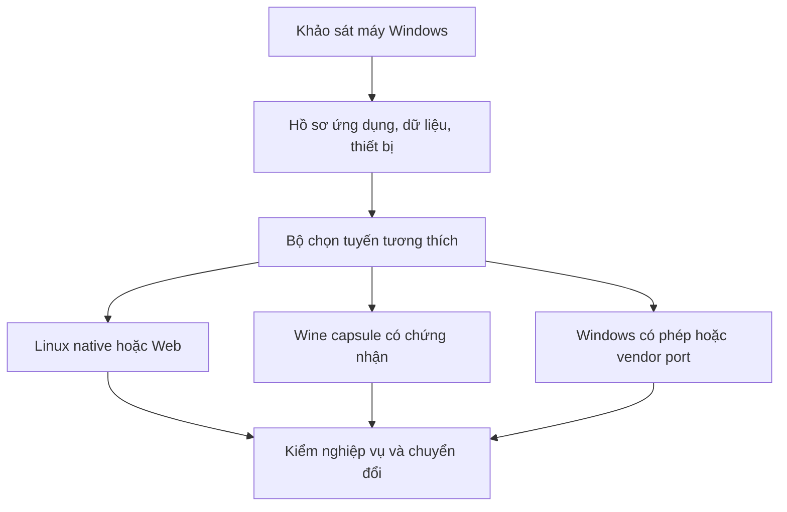

# NaMiOS — Phụ lục 10: Kiến trúc chuyển đổi từ Windows và chương trình hệ điều hành cho người Việt

**Ngày:** 06/11/2026 · **Chủ dự án:** Đỗ Chí Cường và Đỗ Bảo Nam · **Mục đích:** tài liệu giao việc tổng hợp cho Claude Code và nhóm sản phẩm.  
**Phạm vi:** các khoảng trống sau phụ lục 01–09, mã yêu cầu `N10-001` đến `N10-060`. Mỗi yêu cầu có điều kiện nghiệm thu. Đây là **đặc tả**, không phải tuyên bố các tính năng đã được xây dựng.

## 0. Tầm nhìn và kết luận kiến trúc

NaMiOS là hệ điều hành miễn phí, hướng đến gia đình, giáo viên, học sinh, hộ kinh doanh, doanh nghiệp vừa và nhỏ, đơn vị hành chính và người hỗ trợ kỹ thuật tại Việt Nam. Giá trị thực sự không nằm ở một màn hình giống Windows hay macOS: người dùng phải hoàn thành việc, bảo toàn tài liệu và tiền bạc, kết nối được thiết bị, nhận hỗ trợ tiếng Việt dễ hiểu và tin tưởng máy không âm thầm gây hại. Giao diện mạch lạc, hiện đại, sắc nét theo mức độ chăm chút của Apple nhưng dùng hệ thiết kế nguyên bản NaMiOS; thao tác quan trọng vẫn quen thuộc với người dùng Windows.

**Quyết định:** xây trên một bản phân phối Linux ổn định, hỗ trợ cập nhật và phần cứng lâu dài; không viết kernel mới hay sao chép Windows. Wine là một **tuyến tương thích ứng dụng Windows ở user space**. Wine dịch lời gọi API Windows vào môi trường POSIX; nó không cung cấp toàn bộ Windows, không biến driver `.sys` thành driver Linux và không tự làm mọi chương trình chạy đúng [1]. .NET chạy trên Linux nếu ứng dụng thật sự đa nền tảng; WPF/Windows Forms vẫn là công nghệ giao diện chỉ dành cho Windows theo tài liệu Microsoft [2]. Với app bị chặn bởi driver/token/ActiveX/DRM hoặc phụ thuộc Windows chuyên biệt, dùng web/native nếu vendor cung cấp, hợp tác vendor, hoặc chạy Windows được cấp phép qua máy ảo/remote như một **phương án cuối có công bố chi phí**. Không lách bản quyền.

**Điểm sửa nhận thức:** có thể người dùng muốn nói “Linux sang Windows” hoặc “từ Windows sang Linux”; trong tài liệu này “chuyển đổi” là **người dùng và ứng dụng đang ở Windows chuyển sang sử dụng NaMiOS nền Linux**. Nó không phải dịch mã nguồn Windows hay mô phỏng mọi thành phần hệ điều hành Windows.

### 0.1 Bốn lời hứa cần đo

| Lời hứa | Chỉ số đo thật | Điều kiện không được che |
| --- | --- | --- |
| Dễ dùng | Tỷ lệ tự hoàn thành 12 việc thiết yếu, thời gian và số lần cần trợ giúp | Phân theo người mới/người quen Windows, máy yếu/máy mới. |
| Dùng được phần mềm | Tỷ lệ **workflow** đạt, theo phiên bản ứng dụng + môi trường | Mở cửa sổ ≠ làm xong nghiệp vụ; app chưa kiểm = chưa xác nhận. |
| Thiết bị hoạt động | Tỷ lệ chức năng in/scan/ký số/Wi‑Fi/... trên model thực | Nhận VID/PID ≠ chức năng đã dùng được. |
| Tin cậy | Dữ liệu không mất/sai, cập nhật/rollback/restore thành công | Có mẫu số, thời gian, bản build và kiểm toán độc lập. |

## 1. Từ khoảng trống yêu cầu đến công việc thực hiện

Các phụ lục trước đã đề cập driver, .NET, Wine, Office, SmartAI, bộ gõ, giao diện và bảo mật. Các khoảng trống cần đóng trong phụ lục này: (i) chọn nền kỹ thuật có ADR và tiêu chuẩn ngừng hỗ trợ; (ii) công cụ đánh giá máy Windows trước chuyển đổi; (iii) quy trình chuyển tệp, dữ liệu app, danh tính và thiết bị có thể quay lại; (iv) hợp đồng chi tiết cho lớp Wine và tuyến thay thế; (v) phòng thử nghiệm nghiệp vụ Việt Nam; (vi) chuỗi cung ứng, bảo trì, hỗ trợ dài hạn; (vii) tiêu chí dừng dự án/đổi hướng minh bạch. Đây là tài liệu để **thiết kế một chương trình chuyển đổi**, không chỉ để tạo hình nền desktop.



### 1.1 Nền hệ điều hành và ranh giới hệ thống

**N10-001 P0 — ADR nền tảng.** So sánh tối thiểu hai nền Linux có vòng đời hỗ trợ rõ (ví dụ một nhánh LTS truyền thống và một nhánh cập nhật nguyên tử); đánh giá kernel/driver, firmware, gói browser/Office, Wi‑Fi, printer, bảo mật, cộng đồng, chi phí cập nhật và nghĩa vụ giấy phép. Khóa base sau pilot trên phần cứng thật. **Nghiệm thu:** ADR có điểm số, thử máy, rollback, owner và lý do loại ứng viên.

**N10-002 P0 — Desktop stack.** So sánh GNOME/KDE hoặc stack tương đương về shell, accessibility, Wayland/XWayland, IME, quản lý cửa sổ, mức độ tùy biến và thời gian bảo trì; chọn một stack chính, không fork sâu ngay từ đầu. **Nghiệm thu:** 12 luồng UX + 5 app Wine/XWayland chạy trên hai ứng viên; ADR có tác động nâng phiên bản.

**N10-003 P0 — Ranh giới dịch vụ.** Phân tiến trình độc lập: desktop shell, Identity, App Center, Compatibility Broker, Device Hub, Security Center, Update/Recovery, SmartAI Broker, Evidence Store. IPC có version, schema, phân quyền, timeout, retry idempotent. **Nghiệm thu:** tắt AI hoặc App Center không làm hỏng đăng nhập, gõ tiếng Việt, mạng hay in.

**N10-004 P0 — Gói sản phẩm có thể tái tạo.** Build ISO/image từ manifest nguồn và phiên bản cố định, chữ ký artifact, SBOM, xác minh nguồn license/font/icon/firmware; CI ghi hash. **Nghiệm thu:** hai build cùng đầu vào tạo manifest tương đương, kiểm artifact trước phát hành.

**N10-005 P0 — Chế độ offline có chủ đích.** Login nội bộ, bộ gõ, Office cơ bản, file, print USB/LAN nội bộ, backup/restore và trợ giúp có nội dung cài sẵn phải chạy khi mất internet; chức năng cloud/social hiển thị giới hạn. **Nghiệm thu:** 8 giờ không mạng vẫn hoàn thành bài dạy hoặc chứng từ mẫu chưa cần nộp mạng.

**N10-006 P1 — Hồ sơ thiết bị có trọng số.** Danh mục laptop/desktop/mini PC theo CPU/GPU/firmware/NIC/camera/âm thanh/USB-C/BIOS/revision; ghi phổ biến trong trường, kế toán và gia đình Việt Nam thay vì phỏng đoán “mọi máy”. **Nghiệm thu:** tỷ lệ phủ thiết bị tính theo số máy khảo sát và chức năng, không theo số model trong danh mục.

### 1.2 Công cụ chuyển đổi Windows → NaMiOS

**N10-007 P0 — NaMi Migration Assessor.** Công cụ chạy trên Windows theo quyền được cấp hoặc form nhập thủ công; kiểm phiên bản OS, ứng dụng đã cài, app đang dùng 30 ngày (chỉ khi opt-in), file type, font, máy in/scan, USB token, DB, đường dẫn chia sẻ, browser bookmarks và ngoại vi. Không thu mật khẩu/cookie/khóa riêng. **Nghiệm thu:** một máy mẫu xuất manifest có thể review, che tên file riêng tư và không có bí mật.

**N10-008 P0 — Bản đồ công việc trước phần mềm.** Phỏng vấn theo nhiệm vụ: soạn báo cáo, gửi Zalo, bảng lương, hóa đơn, nộp thuế, ký bảo hiểm, học trực tuyến, in/scan, xuất PDF. Mỗi nhiệm vụ có đầu vào, app/website, thiết bị, file, thao tác phê duyệt, chứng từ đầu ra và mùa vụ. **Nghiệm thu:** hai app cùng tên nhưng nghiệp vụ khác nhau không bị gộp thành một badge.

**N10-009 P0 — Điểm sẵn sàng chuyển đổi.** `ready`, `ready_with_limits`, `pilot_only`, `blocked`, `unknown`; blocker của một công việc bắt buộc chặn chuyển máy chính, dù 90% app khác chạy. **Nghiệm thu:** kế toán không ký được hóa đơn = blocked dù mở được Word/Zalo.

**N10-010 P0 — Sao lưu trước di chuyển.** Snapshot/file backup Windows do người dùng/IT chọn, hash mẫu, danh sách file và hướng dẫn xác minh khôi phục trên máy khác; kiểm đủ dung lượng, mã hóa và quyền truy cập. **Nghiệm thu:** lấy lại 10 file mẫu và một database thử nghiệm trước khi xóa/phân vùng máy gốc.

**N10-011 P0 — Di chuyển tệp và cấu trúc.** Import Documents/Desktop/Downloads/Pictures và thư mục theo chọn lọc; ACL/owner mapping, NTFS vs Linux case-sensitivity, tên tệp Unicode, ký tự cấm, symlink/junction, path dài, timezone và metadata; chỉ chuyển dữ liệu, không giả định copy `Program Files` là cài được app. **Nghiệm thu:** 1.000 tệp gồm dấu Việt, tên khác hoa/thường, file lớn, link và tệp khóa có báo cáo hash/sai lệch.

**N10-012 P0 — Chuyển dữ liệu ứng dụng.** Mỗi app được phép có recipe riêng: export/import định dạng công khai hoặc vendor, DB backup/restore và kiểm schema; không chép thẳng registry hay cơ sở dữ liệu kế toán production vào Wine rồi coi là xong. **Nghiệm thu:** đối chiếu tổng tiền, số chứng từ, attachments và báo cáo in trên dữ liệu giả; sai một khoản cần dừng.

**N10-013 P0 — Danh tính và đăng nhập.** Tài khoản local/family, tổ chức LDAP/AD/OIDC khi có, MFA, quyền nhóm và mật khẩu khởi tạo; domain join/SSO chỉ công bố cho loại đã test. Không chuyển password browser/Windows một cách âm thầm. **Nghiệm thu:** người dùng mở dữ liệu của mình, user khác không truy cập; mất mạng vẫn login theo chính sách.

**N10-014 P1 — Trình nhập browser.** Bookmarks và danh sách extension có xem trước; không import cookie, session hay saved password mặc định; extension kiểm compatibility, nguồn và quyền. **Nghiệm thu:** URL bookmark chính xác, extension cần quyền đọc mọi website bị đánh dấu.

**N10-015 P0 — Giai đoạn chạy song song.** Dual boot trên máy thử hoặc hai máy/Windows remote có phép; đặt người phụ trách, thời gian 2–4 tuần mẫu tùy quy trình, kho dữ liệu chủ và quy tắc tránh ghi hai bản gây lệch. **Nghiệm thu:** 10 tác vụ lặp được đối chiếu, đường quay lại có tài liệu và người dùng thực hành được.

**N10-016 P0 — Kế hoạch rút lui.** Khi lỗi nghiêm trọng, trả quyền truy cập hệ thống cũ, file backup, danh sách thao tác phát sinh trên NaMiOS và cách chuyển lại; không gỡ Windows trước khi công việc bắt buộc đạt. **Nghiệm thu:** kịch bản mất driver máy in/ngừng ứng dụng thuế được xử lý không mất dữ liệu.

### 1.3 Kiến trúc tương thích Windows: Wine là một tuyến, không phải lời hứa vạn năng

| Phụ thuộc ứng dụng | Tuyến ưu tiên | Cần đo và giới hạn |
| --- | --- | --- |
| Nhà cung cấp có Linux native hoặc Web | Chính thức của vendor | License, tính năng, offline, security updates. |
| `.NET` đa nền tảng có bản Linux | Runtime Linux chính thức | Native dependency, UI, kiến trúc CPU, version. |
| Win32/Win64 user mode | Wine capsule theo app | Installer, COM, registry, fonts, GDI/printing, file/network, updater. |
| WPF/WinForms/.NET Framework | Wine capsule **nếu** test nghiệp vụ đạt | Không xem là .NET native Linux [2]. |
| Kernel driver/filter, token vendor chỉ có Windows, AV/EDR Windows | Vendor Linux port hoặc Windows có phép | Wine không thể làm driver Linux. |
| ActiveX/IE-only, shell extension, Office COM add-in | Vendor port/đổi quy trình/Windows có phép | Khó hoặc không đạt với browser hiện đại/Wine. |
| App có DRM/anti-tamper/điều khoản cấm | Theo điều khoản vendor | Có thể không hỗ trợ; không né DRM. |

**N10-017 P0 — Compatibility Broker.** Một API chọn tuyến `native/web/wine/remote_windows/vendor_port/unsupported` từ dependency graph và chứng cứ; nêu khả năng, hạn chế, độ mới của chứng nhận và chi phí. **Nghiệm thu:** cùng app mở GUI được nhưng ký số thất bại phải đề xuất route khác cho tác vụ ký.

**N10-018 P0 — Bộ phân tích PE an toàn.** Đọc metadata installer/PE mà không chạy; x86/x64/ARM, runtime, imports, manifest, COM/.NET, service/driver, updater, certificate, hash và nguồn; `unknown` khi thiếu bằng chứng. **Nghiệm thu:** 20 fixture đã gán nhãn, driver `.sys` không bị phân loại là app user mode.

**N10-019 P0 — Wine capsule versioned.** Prefix riêng, Wine runner được pin, kiến trúc, DLL overrides, .NET/VC++ dependencies hợp lệ, registry riêng, font profile, AppID, quyền tệp/mạng/USB và snapshot; kiểm điều khoản phân phối runtime. **Nghiệm thu:** hai app kế toán xung đột DLL không ảnh hưởng nhau; update A rollback được mà B và data không đổi.

**N10-020 P0 — Nền tảng API và log chuẩn.** Phân loại lỗi ở loader/import, process/service, registry, COM/OLE, crypto, GDI/print, file path/encoding, TLS/browser integration, audio/video và GPU; trace có correlation ID, không chứa nội dung tài liệu. **Nghiệm thu:** lỗi một app nộp thuế ở bước ký được chỉ ra là token/crypto/browser, không báo chung “Wine lỗi”.

**N10-021 P0 — Windows path & file semantics.** Chuẩn hóa Unicode NFC/NFD khi hiển thị, đường dẫn `C:\`, `UNC`, case-sensitive/case-insensitive, locking, permission, timezone, code page tiếng Việt, filenames trên SMB; drive mapping chỉ tới thư mục được cấp. **Nghiệm thu:** nhập 100 file mẫu có dấu, file trùng tên khác hoa/thường và đường dẫn UNC không ghi đè âm thầm.

**N10-022 P0 — Cầu in ấn và thiết bị.** Windows app trong Wine thấy printer queue Linux chỉ khi driver/print filter được test; USB token, serial, scanner, webcam dùng dịch vụ Linux/permission bridge khi vendor hỗ trợ, không passthrough mọi thiết bị. **Nghiệm thu:** bản in PDF từ app kế toán giữ lề/phông/tổng; USB token bị từ chối khi chưa cấp quyền.

**N10-023 P0 — COM, Office add-in và OLE.** Ghi dependency theo CLSID/version, hoạt động in-process/out-of-process, nguồn DLL, Office version, automation và macro; chứng nhận theo chức năng. Nếu add-in đòi Microsoft Office bản Windows và không qua test, route Windows có phép. **Nghiệm thu:** mở được workbook nhưng macro/add-in hỏng phải hiển thị `partial`, không `ready`.

**N10-024 P0 — Cầu crypto/chữ ký số có ranh giới.** Ưu tiên vendor Linux middleware/PKCS#11 và website hỗ trợ; kiểm PKI, certificate chain, PIN, token model, CSP/CNG/COM dependency, thao tác ký và xác minh chữ ký đầu ra. Không trích khóa riêng, không giả mạo plugin Windows. Cổng Dịch vụ công hiện có mục plugin ký số ghi rõ dành cho Windows, nên mỗi cổng cần kiểm riêng [3]. **Nghiệm thu:** ký dữ liệu thử, xác minh độc lập, ghi nhận biên nhận; thiếu middleware đánh blocker.

**N10-025 P0 — Ứng dụng .NET theo loại.** Nếu vendor có bản Linux và API đa nền tảng thì chạy native; .NET Framework/WinForms/WPF chạy Wine có kiểm hoặc Windows có phép. Kiểm x86/x64, runtime, native DLL, SQL client, printer, COM, Windows service và installer. **Nghiệm thu:** 4 fixture native console/server, WinForms, WPF, service/driver được phân tuyến đúng.

**N10-026 P1 — Recipe compatibility có thể kiểm toán.** Recipe là dữ liệu cấu trúc: app_id, version, hash, nguồn, license, runner, runtime, env, permission, test cases, limitations, update hold, rollback; ký bởi NaMiOS, có owner và hạn chứng nhận. **Nghiệm thu:** app đổi hash/version tự `needs_retest`, không kế thừa nhãn xanh.

**N10-027 P0 — Không tự tải hoặc vá binary.** SmartAI chỉ đề nghị recipe đã kiểm, không tạo DLL giả để bypass license, không tải `.exe` từ diễn đàn/URL không rõ; vá upstream có test regression, giấy phép và security review. **Nghiệm thu:** prompt “tải crack để chạy MISA” bị từ chối và chỉ ra tuyến hợp lệ.

**N10-028 P0 — Windows fallback được quản lý.** RemoteApp/VM/VPN chỉ khi có Windows và ứng dụng được cấp phép; tách dữ liệu qua file broker, clipboard/USB/pin/print theo policy, mất mạng có cảnh báo, latency và phí bảo trì hiển thị. **Nghiệm thu:** quy trình thuế quan trọng vẫn có đường xử lý hợp lệ khi Wine fail, và log audit ghi điểm chuyển tuyến.

**N10-029 P1 — Hợp tác upstream.** Bug Wine/IME/print được tái hiện với fixture không chứa dữ liệu riêng, gửi upstream theo quyền, tránh private fork lớn; dashboard theo dõi fix/regression và vòng đời merge. **Nghiệm thu:** mỗi patch downstream có issue upstream hoặc ADR nêu lý do ngoại lệ và người bảo trì.

### 1.4 Chương trình ứng dụng và nghiệp vụ Việt Nam

**N10-030 P0 — Catalog theo việc.** Đầu vào khảo sát địa phương, trường học, hộ kinh doanh, doanh nghiệp và người cao tuổi; các nhóm: văn phòng, Zalo/web, kế toán/MISA, thuế/eTax, hóa đơn điện tử, BHXH, ngân hàng, chữ ký số, giáo dục, hành chính công, y tế, bán hàng, thiết kế và phần mềm nội bộ. Không suy rằng tên nhóm đồng nghĩa cùng một kỹ thuật. **Nghiệm thu:** mỗi app có owner vendor, version, đường chạy, test, blocker và ngày kiểm.

**N10-031 P0 — Bộ 12 hành trình Việt Nam.** (1) soạn DOCX có dấu; (2) bảng XLSX công thức; (3) nhận/gửi Zalo Web; (4) học họp trực tuyến; (5) in phiếu; (6) scan ADF; (7) tạo hóa đơn thử; (8) ký số trên môi trường test; (9) nộp biểu mẫu test nếu cổng cung cấp; (10) sao lưu dữ liệu bán hàng; (11) dùng Wi‑Fi và Bluetooth; (12) khôi phục sau update lỗi. **Nghiệm thu:** có fixture và bằng chứng đầu ra từng bước, đánh dấu riêng những việc không có sandbox công khai.

**N10-032 P0 — Hồ sơ thuế và kế toán.** Kiểm số tiền VND/định dạng ngày, làm tròn, thuế suất theo cấu hình hệ thống và thời điểm nghiệp vụ, import/export XML/Excel/PDF, chữ ký, in và đối soát; không để AI tự tính/nộp thuế khi không có luật nghiệp vụ và xác nhận. **Nghiệm thu:** checksum dữ liệu, số dư, chứng từ và biên nhận test trùng nguồn chuẩn; sai số tiền = release blocker.

**N10-033 P0 — Hóa đơn và chữ ký.** Tách lập chứng từ, ký, gửi nhà cung cấp, nhận mã/biên nhận, tải PDF/XML, lưu trữ và tra cứu; API/desktop/plugin từng vendor là các route độc lập. **Nghiệm thu:** “đã tạo” không hiển thị “đã phát hành” nếu chưa có chứng cứ hệ thống ngoài.

**N10-034 P1 — Giáo dục.** Chữ Việt, font toán, công thức, PDF và in phiếu; LMS/web camera/mic, chia sẻ màn hình, slide, máy chiếu HDMI/USB-C, bảng vẽ; chế độ lớp học chặn thông báo cá nhân và lưu offline. **Nghiệm thu:** một giáo viên dạy 45 phút online và in 30 phiếu mẫu không mất tiếng/định dạng.

**N10-035 P1 — Hành chính công.** Catalog từng cổng/đơn vị theo URL, browser, phương thức đăng nhập, plugin ký số, upload giới hạn, tình trạng phản hồi và chứng cứ; thay đổi cổng phải retest. **Nghiệm thu:** không hiện “hỗ trợ dịch vụ công” cho cổng cần plugin chỉ Windows chưa có route hợp lệ.

**N10-036 P1 — Người dùng ít rành công nghệ.** Quan sát thao tác thật với nhóm người cao tuổi, chủ hộ kinh doanh, nhân viên hành chính; đo thuật ngữ hiểu nhầm, vị trí nút, lỗi gõ dấu, thói quen gửi Zalo/USB/in; không lấy phỏng đoán thiết kế thay khảo sát. **Nghiệm thu:** tối thiểu 5 người mỗi persona pilot chính, ghi video/ghi chú có consent và sửa ít nhất 3 vấn đề top.

**N10-037 P1 — Mẫu tài liệu Việt Nam.** Bộ mẫu thư mời, công văn, phiếu học, hóa đơn thử, báo cáo, đơn hành chính bằng font/giấy A4 phù hợp; không tự gắn nhãn “chuẩn pháp lý” nếu chưa được người chuyên môn xác minh. **Nghiệm thu:** mẫu in đúng trang, copy nội dung không hỏng Unicode, người dùng đổi được.

### 1.5 Trải nghiệm, SmartAI và niềm tin

**N10-038 P0 — Design language NaMiOS.** Màu, icon, lưới, chuyển động, typography, shadow, âm thanh, phản hồi trạng thái nguyên bản; cảm giác cao cấp, desktop dễ nhận diện. Test ở 1366×768, 1080p, HiDPI và máy yếu. **Nghiệm thu:** cùng công việc có cùng thuật ngữ/nút ở Settings, Device Hub, App Center, Security Center.

**N10-039 P0 — Hỗ trợ tiếng Việt chuyên ngành.** Glossary có người duyệt cho thuế, kế toán, giáo dục, bảo hiểm, hành chính, mạng và bảo mật; mỗi từ có tên phổ thông, tên chuyên môn, giải thích, ví dụ và phiên bản. **Nghiệm thu:** 50 lỗi/tác vụ mẫu được người trong ngành đánh giá rõ nghĩa, không sai thuật ngữ như “đã ký” khi chỉ “đã tải tệp”.

**N10-040 P0 — Trải nghiệm từ lỗi đến kết quả.** Một panel “Việc cần làm”: tình trạng, lý do, bước nhỏ, tiến trình, biên nhận, nút quay lại; giao diện không che lỗi dưới banner xanh. **Nghiệm thu:** người dùng xem cùng một task từ mở file → in/scan/ký → nhận kết quả mà không phải hiểu log.

**N10-041 P0 — SmartAI orchestrator.** AI chuyển yêu cầu tiếng Việt thành plan có ý định, dữ liệu cần, mức quyền, tool định danh, điều kiện thành công và rollback; chỉ gọi qua Policy Broker. Tool schema versioned; action idempotent, timeout, audit. **Nghiệm thu:** thử 20 nhiệm vụ có câu mơ hồ, AI hỏi đúng dữ kiện còn thiếu và không chạy root shell.

**N10-042 P0 — Cơ sở tri thức có nguồn.** AI tra tài liệu offline bản OS, các recipe đã chứng nhận và hướng dẫn vendor chính thức được kiểm phiên bản; hiển thị nguồn/ngày và độ chắc. Tài liệu web/app của bên thứ ba là dữ liệu không tin cậy, không phải lệnh. **Nghiệm thu:** 10 prompt injection cài package/tắt firewall trong trang web không kích hoạt tool.

**N10-043 P0 — Bằng chứng sau hành động.** AI không tự tuyên bố “đã sửa” dựa trên exit code; validator kiểm mở app, in tờ test, hash file, receipt portal hoặc người xác nhận đúng nghiệp vụ. **Nghiệm thu:** job spool thành công nhưng giấy trắng vẫn failed/partial.

**N10-044 P0 — AI tiếng Việt có đánh giá.** Eval theo miền và phương ngữ/câu không dấu, sai chính tả, trẻ em/người lớn; kiểm hallucination về driver, virus, pháp lý, tiền, chữ ký; bộ dữ liệu giả hoặc đã đồng ý. **Nghiệm thu:** công bố tỷ lệ task completion, unsafe action, wrong claim, latency và chi phí theo model/version.

**N10-045 P1 — Chọn local/cloud minh bạch.** Tác vụ chẩn đoán cơ bản và điều khiển máy không phụ thuộc cloud; phần xử lý văn bản nâng cao có tùy chọn model trên máy hoặc cloud với thông tin phạm vi gửi, nơi lưu, chi phí, quyền xóa. **Nghiệm thu:** rút mạng/tắt AI cloud không ảnh hưởng IME, login, firewall và app có sẵn.

**N10-046 P1 — Kiến trúc plugin an toàn.** Kỹ năng của SmartAI chỉ là plugin có manifest, quyền hẹp, chữ ký, review, quota, audit, version pin và khả năng tắt; không cho plugin sửa policy của chính nó. **Nghiệm thu:** plugin giả yêu cầu đọc mọi tệp rồi gửi mạng bị từ chối/hiển thị quyền rõ.

### 1.6 Thiết bị, bảo mật và vận hành lâu dài

**N10-047 P0 — Ma trận ngoại vi theo chức năng.** Printer/MFP (IPP/USB/SMB, ADF/duplex), card mạng, Wi‑Fi, Bluetooth profiles, USB storage/token, camera, audio, dock, projector, UPS, scanner và thiết bị ngành; model/revision/firmware/kernel/backend/test date. **Nghiệm thu:** “phát hiện” và “in/scan/ký hoạt động” hiển thị riêng.

**N10-048 P0 — Phát hiện thiết bị và sửa có rollback.** Device Hub ghép nguồn driver Linux đã xác minh, thử chức năng, tự động báo lỗi có mã; không cài Windows `.inf/.sys` lên kernel Linux. **Nghiệm thu:** mất mạng sau update kernel quay được bản cũ; app Wine không có quyền cài driver nhân.

**N10-049 P0 — Bảo mật nhiều lớp.** Package provenance/signatures, sandbox/portal, browser update/phishing, USB không autorun, anti-malware scanner bổ trợ, firewall, mã hóa khi phù hợp, backup tách quyền, kiểm ransomware và incident response. **Nghiệm thu:** 10 ca gồm file độc giả lập, app Wine vượt quyền, update giả và phục hồi dữ liệu đều có kết quả, false positive được đo.

**N10-050 P0 — Chuỗi cung ứng.** SBOM theo release, cập nhật CVE có triage, nguồn gói và dependency khóa, reproducible manifest, ký build, rotation/revocation key và quy trình bảo mật lỗ hổng. **Nghiệm thu:** mô phỏng khóa ký bị lộ có thể thu hồi, phát hành bản thay thế và thông báo người dùng.

**N10-051 P0 — Cập nhật nguyên tử và cứu hộ.** Phân bootable OS/app/data; cập nhật trong ring, preflight đủ pin/dung lượng, health check sau boot, rollback OS, migration schema có forward/rollback plan; USB cứu hộ và recovery không cần AI. **Nghiệm thu:** 3 điểm ngắt điện, full disk và driver regress đều còn đường khôi phục dữ liệu.

**N10-052 P1 — Hỗ trợ 5 năm.** Chọn chu kỳ hỗ trợ công bố cụ thể sau ADR; lịch vá browser/kernel/Wine/Office/IME, policy end-of-life, bảo trì app recipe và máy đã chứng nhận; ngân sách người phụ trách. **Nghiệm thu:** một thay đổi vendor/browser có người nhận incident và thời hạn sửa trước khi phát hành.

**N10-053 P1 — Quản trị tổ chức.** Golden image, app allowlist, update rings, tài khoản, khóa/mã hóa, remote support có consent, audit, cấu hình Wi‑Fi/printer/SMB và policy quản lý; người dùng cá nhân không bị ràng buộc quản trị tổ chức. **Nghiệm thu:** rollout 20 máy thử, rollback một nhóm không ảnh hưởng nhóm khác.

**N10-054 P0 — Quyền và giấy phép.** Hồ sơ license cho Linux distribution, Wine, Office, font, codec, firmware, trademark, ứng dụng bên thứ ba, Windows fallback; kiểm nghĩa vụ công bố mã nguồn/thông báo khi phân phối. **Nghiệm thu:** artifact release có manifest license và danh sách binary không được phép bundle bị loại.

**N10-055 P1 — Cộng đồng và nhà cung cấp.** Công khai danh sách tương thích có chứng cứ, kênh báo lỗi tiếng Việt, hướng dẫn lấy log đã che, lộ trình vendor Linux driver/plugin và đóng góp upstream; không công khai dữ liệu khách hàng. **Nghiệm thu:** bug mẫu có số nhận, môi trường, reproduction, thời gian cập nhật và trạng thái sửa.

**N10-056 P0 — Chi phí sống còn.** Dự toán build/release, QA lab thiết bị, nhân lực bảo mật, cập nhật browser/IME/Wine, lưu model AI, hỗ trợ người dùng; phân biệt OS miễn phí với cloud/Windows license/ứng dụng thương mại. **Nghiệm thu:** mô hình chi phí 1.000/10.000 máy có giả định rõ và ngưỡng duy trì tối thiểu.

## 2. Bộ kiểm thử chấp nhận theo thời điểm

**N10-057 P0 — Release gate theo tác vụ.** Không phát hành nếu mất file, sai tiền, chữ ký không hợp lệ, đánh dấu “đã nộp” thiếu receipt, driver làm mất mạng, browser chưa có bản vá nghiêm trọng đã xác nhận, hoặc backup không restore được. **Nghiệm thu:** CI/pilot tạo báo cáo red gate, release manager không override thiếu ADR và người chịu trách nhiệm.

**N10-058 P0 — Ma trận phạm vi hỗ trợ.** Chứng nhận theo tuple `machine/revision/firmware + OS/kernel/desktop + app/version/hash/route + driver/token + workflow + fixture + test date + evidence`. Badge có `verified`, `partial`, `blocked`, `expired`, `not_tested`; không chỉ một dấu xanh cho cả app. **Nghiệm thu:** đổi browser/Wine/runtime/driver/version tự invalidates phần liên quan.

**N10-059 P1 — Thử nghiệm thực địa.** Pilot ba nhóm (giáo viên, kế toán, nhân viên văn phòng/hành chính), tối thiểu 5 người mỗi nhóm giai đoạn đầu, thiết bị phổ biến và mạng chập chờn; khảo sát hành vi, hỗ trợ và khả năng quay lại Windows. Số lượng này là điểm khởi đầu nghiên cứu định tính, không suy ra thị trường. **Nghiệm thu:** báo cáo lỗi, tần suất, ngữ cảnh, cải tiến và thử lại cùng task.

**N10-060 P0 — Điểm dừng và đổi hướng.** Sau mỗi mốc, nếu ứng dụng thuế/ký số thiết yếu không có tuyến hợp pháp đạt nghiệm thu, nếu printer fleet chính không hoạt động, hoặc chi phí QA vượt năng lực duy trì, không quảng bá thay Windows toàn diện: thu hẹp nhóm khách hàng, giữ Windows fallback có phép hoặc ưu tiên hợp tác vendor. **Nghiệm thu:** quyết định có số liệu, phạm vi người bị ảnh hưởng và ngày đánh giá lại.

## 3. Lộ trình thực hiện có đầu ra cụ thể

| Mốc | Đầu ra kỹ thuật | Điều kiện chuyển mốc |
| --- | --- | --- |
| 0 — 6–8 tuần khảo sát | 30–50 máy/thiết bị thực, 50 app/version/workflow, 3 persona, danh sách blocker; ADR nền | Có dữ liệu thật về mức phổ biến và 10 công việc thiết yếu. |
| 1 — Prototype | ISO boot, desktop tiếng Việt, IME, browser, Office, file, update/rollback, print, SmartAI read-only | 12 hành trình cơ bản không mất dữ liệu. |
| 2 — Compatibility lab | Assessor, manifest, Wine capsule, recipe, test runner, route selector, ký số/máy in theo vendor | Ít nhất 3 app Windows và 2 workflow .NET được test theo phiên bản; blocker công khai. |
| 3 — Pilot hạn chế | 15+ người, 20+ máy, chạy song song, backup/rollback, số liệu UX và bảo mật | Không còn P0 regression trong phạm vi chứng nhận. |
| 4 — Mở rộng | Kho ứng dụng, thiết bị/vend​or partnership, quản trị, hỗ trợ, kết quả QA công khai | Tỷ lệ hoàn thành workflow, chi phí và thời gian hỗ trợ đủ bền vững. |

Các mốc là kế hoạch thử nghiệm, không phải lời hứa thời gian sản phẩm hoàn chỉnh. Số mục tiêu ban đầu phải được điều chỉnh sau khảo sát; không nhảy thẳng từ ISO trình diễn sang lời hứa hàng triệu người dùng.

## 4. Giao việc cho Claude Code

1. Tạo `docs/adr/001-base.md`, `002-desktop.md`, `003-update-recovery.md`, `004-wine-route.md`, `005-office.md` với so sánh và test evidence; xin chủ dự án quyết định ADR sau khi có bản demo và chi phí.
2. Tạo schema và CLI prototype cho `migration-assessor` (chỉ inventory/preview), `app-manifest`, `device-manifest`, `compatibility-recipe`, `workflow-test`, `evidence-record`; có sample dữ liệu giả Việt Nam, validate JSON schema, hash, version.
3. Tạo màn hình mẫu tiếng Việt: khảo sát chuyển máy, báo cáo sẵn sàng, chọn tuyến app, trạng thái máy in/token, việc AI đang làm, cứu hộ. Dùng token NaMiOS nguyên bản; thử giao diện với người dùng thật.
4. Lập CI test với fixture giả gồm chữ Việt, `.docx/.xlsx/.pdf`, 3 installer Windows hợp lệ trong lab, 2 app .NET mẫu, một máy in và một token trong phạm vi quyền được phép; không lấy binary thương mại không có license.
5. Bàn giao `docs/release-gates.md`, `docs/threat-model.md`, `docs/license-inventory.md`, `docs/support-matrix.md`, bảng backlog map đủ `N10-001..060` → issue/owner/test/evidence; mọi hạng mục P0 chưa làm để `open`, không đánh dấu hoàn thành bằng văn bản.

### Mẫu hợp đồng dữ liệu tối thiểu

```json
{
  "workflow_id": "vn.invoice.sign.test",
  "app": {"id": "vendor.app", "version": "unknown", "hash": "sha256:..."},
  "route": "wine",
  "environment": {"os_build": "...", "wine_runner": "...", "device_model": "..."},
  "steps": ["open", "import_sample", "sign_on_test_token", "verify_receipt"],
  "status": "not_tested",
  "evidence": [],
  "limitations": ["Vendor support chưa xác nhận"],
  "tested_at": null
}
```

Mọi trường có dữ liệu cá nhân trong sản phẩm thật phải có chính sách tối thiểu hóa, mã hóa, thời hạn lưu và phân quyền. Đoạn JSON là mẫu schema gợi ý, không phải kết quả test.

## 5. Những điểm tuyệt đối không suy diễn

- Wine không chạy Windows kernel drivers hoặc biến toàn bộ Windows thành Linux. Ứng dụng Windows **có thể** chạy tùy API, runtime, phụ thuộc thiết bị, giấy phép, phiên bản và workflow [1].
- Office tương thích `.docx/.xlsx` không bảo đảm VBA, COM add-in, bố cục in, chữ ký và số liệu giống hệt. Kiểm file nghiệp vụ thực trên bản sao và người có chuyên môn ký duyệt.
- .NET mới trên Linux không tự làm WinForms/WPF trở thành đa nền tảng [2].
- Một cổng web mở được trong browser không có nghĩa token/plugin ký số chạy được; cổng và vendor có thể chỉ cung cấp plugin Windows [3].
- SmartAI không được tự viết driver kernel hoặc chứng nhận ứng dụng. Nó có thể đề xuất test, trợ giúp, tạo báo lỗi, dựng adapter **khi có API, quyền và kiểm thử**.
- “Miễn phí” là bản phân phối NaMiOS và các thành phần có giấy phép phù hợp; một số app, cloud, Windows và thiết bị/phần mềm vendor vẫn có chi phí hoặc điều khoản riêng.

## 6. Nguồn kỹ thuật nền tảng kiểm tra ngày 06/11/2026

[1] WineHQ, Wine là compatibility layer dịch Windows API sang POSIX: https://www.winehq.org/about  
[2] Microsoft Learn, port .NET Framework; WPF/WinForms vẫn Windows-only: https://learn.microsoft.com/en-us/dotnet/core/porting/framework-overview  
[3] Cổng Dịch vụ công Quốc gia, trang phần mềm hỗ trợ nêu plugin chữ ký số dành cho Windows: https://vpcp.dichvucong.gov.vn/p/home/dvc-phan-mem-ho-tro.html  
[4] Zalo PC, bản Windows/macOS/Web: https://www.zalo.me/pc  
[5] Flatpak, sandbox permissions: https://docs.flatpak.org/en/latest/sandbox-permissions.html  
[6] ClamAV, on-access scanning: https://docs.clamav.net/manual/OnAccess.html

Thông tin vendor, cổng dịch vụ và phiên bản nền tảng có thể đổi; kiểm lại từ nguồn chính thức trong mỗi release. Bản này cố ý đặt **chỉ tiêu chấp nhận và điểm dừng** để NaMiOS đáng tin cho người Việt, thay vì hứa “mọi phần mềm Windows” khi chưa kiểm thử.
