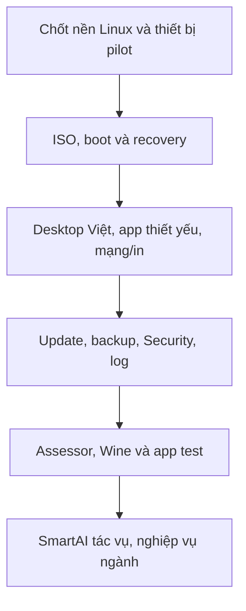

# NaMiOS — Phụ lục 13: Ưu tiên nâng cấp để đi từ đặc tả đến hệ điều hành dùng được

**Ngày:** 07/11/2026 · **Chủ dự án:** Đỗ Chí Cường và Đỗ Bảo Nam · **Loại:** kế hoạch triển khai độc lập, tiếp nối các phụ lục 01–12.  
**Điểm xuất phát:** chưa có quyền truy cập mã nguồn/bản ISO và báo cáo kiểm thử NaMiOS trong tài liệu này. Các phụ lục trước là **yêu cầu**, không được coi là bằng chứng chức năng đã tồn tại. Nếu nhóm đã có bản chạy, thực hiện kiểm kê và đối chiếu trạng thái trước khi nhận backlog dưới đây.

## 1. Lời khuyên kiến trúc

Đợt này không cần thêm hàng trăm tính năng. NaMiOS cần **một vòng khép kín**: cài an toàn → đăng nhập/gõ tiếng Việt → mở ứng dụng → kết nối thiết bị → hoàn thành một công việc → cập nhật → nếu lỗi thì khôi phục. Đó là nền để sau này nâng cấp liên tục mà người dùng tin tưởng. Chạy được một app Windows không làm nên hệ điều hành; mất dữ liệu sau update hoặc không in được tài liệu sẽ khiến họ quay về Windows.

Một số nền Linux đã có cơ chế deployment mới và rollback, ví dụ rpm-ostree chuẩn bị bản cập nhật thành deployment để áp dụng khi khởi động lại và có lệnh rollback [1]. Đây là **tham khảo về năng lực**, không phải quyết định NaMiOS phải chọn Fedora/rpm-ostree. Cần ADR so sánh theo phần cứng, gói ứng dụng và năng lực bảo trì. Wine chỉ là lớp tương thích cho ứng dụng Windows, cần kiểm theo từng app và công việc [2].

### Quy tắc ưu tiên

| Mức | Ý nghĩa | Quyết định |
| --- | --- | --- |
| **P0 — sống còn** | Không có thì máy chưa đáng tin để dùng thường ngày | Bắt buộc trước pilot có người dùng thật. |
| **P1 — chuyển đổi** | Giúp người từ Windows hoàn thành việc phổ biến | Làm khi P0 có bản chạy và đo được. |
| **P2 — mở rộng** | Giá trị lớn cho doanh nghiệp/ngành hẹp hoặc quy mô nhiều máy | Làm theo số liệu khảo sát và đối tác. |

## 2. Mười bốn năng lực cần nâng cấp tiếp

| ID | Năng lực | Mức | Đầu ra cụ thể | Cửa kiểm chứng |
| --- | --- | --- | --- | --- |
| U13-01 | **Ảnh cài và cài đặt an toàn** | P0 | ISO/USB cài, live mode, kiểm tương thích phần cứng, phân vùng, mã hóa tùy chọn, đường quay về Windows | Trên 5 máy pilot: cài mới, cài cạnh Windows và hủy giữa chừng đều không làm mất dữ liệu. |
| U13-02 | **Cập nhật và khôi phục OS** | P0 | Update Center, bản boot trước, health check, rollback, USB cứu hộ | Mất điện/hết dung lượng/update lỗi vẫn khởi động hoặc vào recovery, file cá nhân còn. |
| U13-03 | **Sao lưu dữ liệu người dùng** | P0 | Backup theo phiên bản, đích tách quyền, lịch, báo lỗi và restore preview | Khôi phục 10 file đúng hash và một hồ sơ trình duyệt thử nghiệm; không ghi đè âm thầm. |
| U13-04 | **Desktop tiếng Việt đủ dùng** | P0 | Login, Launcher, thanh ứng dụng, File, Settings, bộ gõ, PDF/Office, phím tắt | 10 người thử tự làm 8 việc: gõ, lưu, tìm, mở, in, Wi‑Fi, cài app, tắt máy. |
| U13-05 | **App Center và bộ thiết yếu** | P0 | Browser, Office, IME, Security Center; shortcut chính thức Zalo/YouTube/Maps/Facebook/TikTok/WhatsApp | Phân biệt native/web/Wine, nguồn và quyền; không tự đăng nhập dịch vụ bên thứ ba. |
| U13-06 | **Mạng và ngoại vi ưu tiên** | P0 | Wi‑Fi, Ethernet, Bluetooth HID/audio, USB, 3–5 printer/MFP được chọn từ khảo sát | Mỗi model có ca in/scan/kết nối thực, lỗi và mức hỗ trợ theo chức năng. |
| U13-07 | **Bảo mật mặc định** | P0 | Signed updates, quyền người dùng, sandbox/portal, firewall, browser patch, scanner bổ trợ, Security Center | File tải/USB/app Wine thử vượt quyền bị xử lý; không hứa chống 100% virus. |
| U13-08 | **Chẩn đoán và hỗ trợ** | P0 | Mã lỗi nhất quán, lịch sử update/crash, log đã che, nút hoàn tác, hướng dẫn tiếng Việt | Người dùng/IT phân biệt mất mạng, thiếu driver, quyền bị từ chối, app crash trong 3 màn hình. |
| U13-09 | **Bộ chọn tuyến app Windows** | P1 | Catalog `native/web/Wine/Windows có phép/chưa hỗ trợ`, dependency graph, hồ sơ version/test | App .NET mở GUI nhưng không in/ký được phải là partial hoặc blocked, không gắn ready. |
| U13-10 | **Wine capsule có kiểm soát** | P1 | Prefix riêng, runner/runtime pin, quyền file/network/USB hẹp, snapshot, recipe | Hai app xung đột DLL không ảnh hưởng nhau; app đổi hash cần retest; malware fixture không đọc toàn bộ home. |
| U13-11 | **Công cụ chuyển từ Windows** | P1 | Inventory app, font, tệp, máy in, token và công việc; báo cáo sẵn sàng, backup trước chuyển | Một công việc thiết yếu bị chặn thì không khuyên thay Windows; import 1.000 tệp kiểm hash. |
| U13-12 | **SmartAI giải quyết việc thật** | P1 | Hỏi tiếng Việt, diagnostic read-only, plan/permission/rollback, kiểm kết quả | Giải 10 ca mạng/in/IME thường gặp; tắt AI máy vẫn boot, gõ, in và cập nhật. |
| U13-13 | **Nghiệp vụ Việt Nam theo đối tác** | P2 | MISA/kế toán, thuế, hóa đơn điện tử, bảo hiểm, dịch vụ công, ký số theo vendor/cổng | Mỗi nghiệp vụ có dữ liệu test, chữ ký/biên nhận/số tiền đối chiếu; thiếu middleware phải công bố blocker. |
| U13-14 | **Quản trị nhiều máy và cộng đồng** | P2 | Update rings, policy tổ chức, golden image, hỗ trợ từ xa có consent, báo lỗi tiếng Việt | Pilot 20 máy theo nhóm, rollback một nhóm không ảnh hưởng nhóm khác; ticket có owner. |

### 2.1 Phần quan trọng nhưng dễ bị quên

- **Âm thanh, camera, micro và chia sẻ màn hình:** phải qua test họp/học trực tuyến 45 phút; loa, tai nghe Bluetooth, webcam và quyền site rõ. Đưa vào U13-06/U13-04, không chờ tới khi làm “phần mềm giáo dục”.
- **Pin, ngủ/đánh thức và laptop đóng nắp:** đo trên máy cũ, mới, dock, hai màn hình. Mất mạng/âm thanh sau resume là lỗi P0 của U13-01/U13-06.
- **Đồng hồ, múi giờ, chứng chỉ và TLS:** sai giờ gây lỗi website, ký số, update. Kiểm khi offline, dual boot và đổi mạng.
- **Tệp mạng và chia sẻ:** SMB/NAS, máy in qua mạng, ACL và tên file có dấu. Test theo môi trường văn phòng trước khi hứa “thay Windows”.
- **Khả năng tiếp cận:** screen reader, text scaling 200%, keyboard focus và giảm chuyển động cần được test trong U13-04, không coi là trang trí P2.
- **Bản quyền và nguồn gói:** Office, firmware, codec, font, hình nền, logo, app bên thứ ba có manifest license. Bộ logo hoa sen v1.0 là tài sản thương hiệu đề xuất; tra cứu trùng lặp trước phát hành đại trà.

## 3. Thứ tự triển khai theo phụ thuộc

Không hiểu sơ đồ là SmartAI chỉ được bắt đầu sau Wine; có thể làm prototype UI sớm. **Phụ thuộc bắt buộc** là SmartAI không được thay policy bảo mật, không là điều kiện cho boot/recovery và không tự xác nhận app hoạt động.

| Mốc | Việc phải chạy trên máy | Bằng chứng cần có | Quyết định |
| --- | --- | --- | --- |
| **M0: khảo sát** | Inventory 30–50 máy/app/workflow ở 3 nhóm người dùng đầu tiên; so sánh nền Linux | Danh sách model/chipset/driver, 20 việc quan trọng, ADR | Chọn 5 máy và 3 máy in làm lab, không chọn theo cảm tính. |
| **M1: máy dùng được** | ISO + desktop Việt + Office/browser/IME + Wi‑Fi/USB/in | Video 8 việc, lỗi/crash, ảnh output/tờ in, bản build | Chỉ mở pilot nhỏ nếu U13-01/04/05/06 P0 đạt. |
| **M2: máy đáng tin** | Update/rollback/backup/security/diagnostics | Test mất điện, restore hash, scanner false positive, log sạch bí mật | Chưa đạt thì không khuyên người dùng thay máy chính. |
| **M3: chuyển đổi** | Assessor + catalog + 3 app Wine/.NET cụ thể | App/version/hash + workflow + thiết bị + kết quả + blocker | Không gắn “hỗ trợ Windows” cho cả ngành chỉ từ 3 app. |
| **M4: mở rộng** | SmartAI hữu ích + ký số/thuế/kế toán theo vendor + quản trị | Biên nhận test và người nghiệp vụ ký duyệt | Mở rộng theo nhóm máy/ngành thực sự đạt. |

## 4. Một quyết định cần ưu tiên ngay: chọn nhóm người dùng đầu tiên

**Đề xuất:** gia đình, giáo viên và nhân viên văn phòng có công việc chủ yếu trên browser/Office/Zalo Web/PDF/in ấn. Họ giúp đo trải nghiệm tiếng Việt và thiết bị phổ biến. Nhóm kế toán, thuế, ký số và hành chính công thử trong lab/pilot với đối tác riêng, vì một bước ký/nộp hỏng có thể gây hậu quả nghiệp vụ. Đây là **ưu tiên sản phẩm**, không có nghĩa bỏ nhóm chuyên ngành; chỉ mở lời hứa hỗ trợ khi app/token/cổng và workflow được chứng nhận.

### Dữ liệu cần từ chủ dự án và đội pilot

1. 5 mẫu laptop/desktop thực tế, 3 model máy in/MFP, 2 thiết bị Bluetooth, 2 loại USB token nếu có quyền test.
2. Danh sách 20 phần mềm/website **kèm phiên bản** và 10 công việc mà người dùng phải làm xong; ưu tiên nhóm giáo viên/văn phòng.
3. Một bản sao dữ liệu thử không chứa thông tin thật: DOCX/XLSX/PDF, ảnh, bản in, database demo; giấy phép phần mềm/vendor nếu test binary thương mại.
4. Nhóm 15–20 người pilot, tình huống mạng chậm/mất mạng, máy cũ và máy mới; một người phụ trách ra quyết định release.

## 5. Cách giao cho Claude Code: làm bản chạy, không viết tiếp checklist

**Sprint A — nền sản phẩm:** tạo repo, ADR distro/desktop/update model, build ISO có thể tái tạo, live boot, login tiếng Việt và bộ gõ. Demo trên một laptop/desktop có mã build.

**Sprint B — công việc hằng ngày:** File, browser, Office, Zalo Web shortcut, PDF, Wi‑Fi/USB/print, các phím tắt chính. Thử 8 việc trên 5 máy; ghi màn hình, log lỗi và ảnh bản in.

**Sprint C — độ tin cậy:** signed update, backup, rollback, Security Center, diagnostics; failpoint mất điện/hết ổ/mất mạng, thử restore. Chặn release khi fail.

**Sprint D — mở rộng:** Assessor Windows, compatibility recipe schema, một capsule Wine cô lập, 3 app/version/workflow được phép test; sau đó SmartAI đọc trạng thái và hướng dẫn sửa lỗi có quyền.

**Mỗi sprint bàn giao:** mã nguồn, lệnh build, artifact ISO hoặc app, danh sách thiết bị, test pass/fail có ảnh/log đã che, lỗi mở và chi phí bảo trì ước lượng. Nếu không có artifact chạy trên máy thật, trạng thái vẫn là `specified`, không phải `completed`.

## 6. Cổng phát hành và câu nói với người dùng

- **Không phát hành pilot** nếu lỗi mất tệp, update không rollback, IME gõ sai trong ứng dụng chính, Wi‑Fi không nối lại sau sleep trên máy đã chứng nhận, in thiếu trang hoặc cảnh báo an toàn sai.
- **Không hứa “mọi phần mềm Windows/driver”**. Công bố app/version/workflow và model thiết bị đã thử; Wine không biến driver Windows thành driver Linux [2].
- **Không hứa AI tự sửa mọi lỗi.** AI có thể tìm nguyên nhân/đề nghị bước sửa; policy và kết quả test quyết định hành động thực.
- **Không mở rộng marketing trước bằng chứng.** Bản thông báo ghi “đã kiểm trên model X với việc Y”, “chưa xác nhận trên model khác”; người dùng có đường quay về Windows hợp pháp khi công việc quan trọng chưa đạt.

## 7. Nguồn đối chiếu kỹ thuật (07/11/2026)

[1] rpm-ostree, Client administration, deployment upgrade và rollback: https://coreos.github.io/rpm-ostree/administrator-handbook/  
[2] WineHQ, Wine là compatibility layer dịch Windows API: https://www.winehq.org/about/  
[3] Flatpak, sandbox permissions: https://docs.flatpak.org/en/latest/sandbox-permissions.html

Các lựa chọn stack/phiên bản là ADR phải dựa vào lab của NaMiOS. Tài liệu này không tuyên bố bản ISO hay các module đã được xây; mục tiêu là giúp đội phát triển **ngừng mở rộng danh sách yêu cầu và bắt đầu hoàn thành vòng sản phẩm đầu tiên**.
