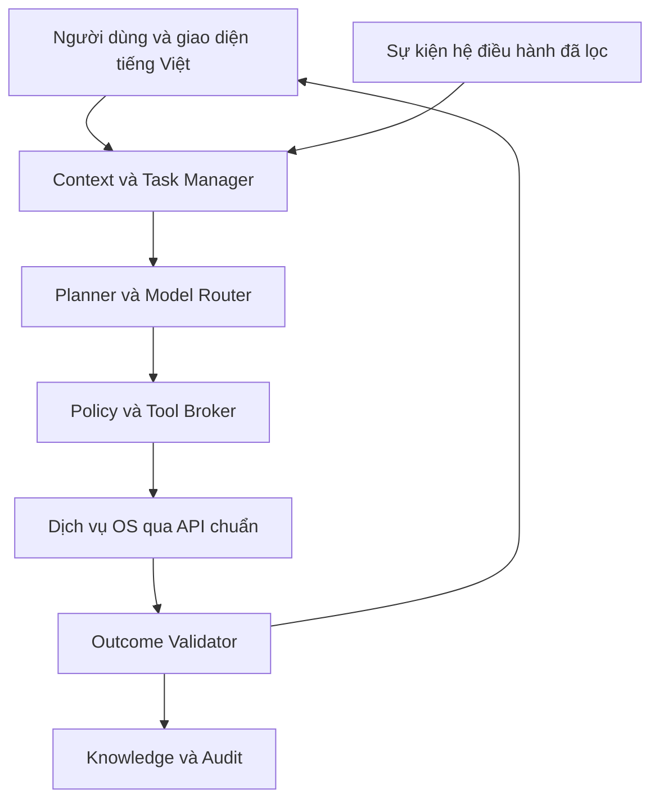

# NaMiOS — Phụ lục 14: SmartAI Core, trợ lý giải quyết công việc cho người Việt

**Ngày:** 09/11/2026 · **Chủ dự án:** Đỗ Chí Cường và Đỗ Bảo Nam · **Trạng thái:** đặc tả kiến trúc độc lập, tiếp nối phụ lục 05, 06, 08, 13 và bộ Brand/UI/UX v1.0.  
**Lưu ý:** tài liệu này quy định sản phẩm cần xây; chưa có mã nguồn, bản ISO hoặc kết quả kiểm thử chứng minh các chức năng đã hoạt động.

## 1. Quyết định kiến trúc cốt lõi

**SmartAI là lớp điều phối và hỗ trợ ở tầng người dùng, không chạy trong Linux kernel và không giữ quyền root thường trực.** OS vẫn khởi động, gõ tiếng Việt, mở tệp, dùng mạng, in, sao lưu và cập nhật khi AI tắt hoặc hỏng. “Linh hồn” của NaMiOS là một trải nghiệm thống nhất: người dùng nói việc cần làm; hệ điều hành hiểu trạng thái thật; AI giải thích và xây kế hoạch; dịch vụ có thẩm quyền thực thi; bộ kiểm chứng xác nhận kết quả; người dùng biết việc đã xong hay còn bị chặn.

SmartAI không hứa tự sửa mọi app Windows, tạo driver từ không khí, tự đăng nhập/nộp hồ sơ, hoặc tự quyết định thay người dùng. Nó phải **tăng tỷ lệ hoàn thành việc thực tế**, giảm thời gian tìm lỗi và giảm số lần phải gọi hỗ trợ.

### 1.1 Sáu hợp đồng không được vi phạm

1. **Sự thật:** câu “đã xong” cần bằng chứng từ dịch vụ và, khi cần, người nhận kết quả. Đã gửi lệnh in ≠ đã có bản giấy; mở được app ≠ nghiệp vụ kế toán chạy đúng.
2. **Quyền:** AI không tự cấp quyền. Mọi công cụ đi qua broker, policy, tài khoản người dùng và cơ chế xác thực của OS; quyền có phạm vi, thời hạn và khả năng thu hồi.
3. **Dữ liệu:** chỉ lấy ngữ cảnh người dùng chọn hoặc policy tổ chức cho phép; log/tệp/web là dữ liệu không tin cậy, không phải chỉ thị có quyền.
4. **Khả năng quay lại:** sửa cấu hình phải có preflight, snapshot/backup thích hợp, kiểm kết quả và rollback hoặc báo rõ không thể đảo ngược.
5. **Tính khả dụng:** AI không là điểm lỗi đơn của desktop; dịch vụ mạng, in, cập nhật, phục hồi hoạt động độc lập.
6. **Minh bạch:** giao diện cho biết AI đã xem dữ liệu gì, dùng model tại máy hay dịch vụ ngoài, sẽ làm gì, phần nào chưa chắc chắn, nút Dừng và lịch sử thao tác.

## 2. Mục tiêu người dùng: tám hành trình đầu tiên

| Hành trình người Việt | Lời nói tự nhiên | Dữ liệu cần xin/đọc | Kết quả đã kiểm chứng |
| --- | --- | --- | --- |
| Kết nối Wi‑Fi | “Máy không vào mạng được” | Adapter, trạng thái radio, bước xác thực/IP/DNS/portal; không đọc mật khẩu | Kết nối mạng và truy cập đích thử do người dùng chấp nhận, hoặc blocker cụ thể. |
| Kết nối máy in | “Cài máy in văn phòng này giúp tôi” | Model, USB/IP/mDNS, IPP, backend, queue; hỏi khi nhiều máy | In trang thử, xác nhận có bản giấy; ghi scan riêng nếu MFP. |
| Bluetooth | “Tai nghe ghép đôi rồi mà không có tiếng” | Adapter, pairing, audio profile và output hiện tại | Âm thanh test phát qua đúng tai nghe hoặc nói rõ profile/driver còn thiếu. |
| Tài liệu | “Mở file Word và in hai mặt” | Tệp được chọn, renderer, font, máy in, duplex | Người dùng xem bản xem trước, in đúng số trang/mặt; nếu fidelity rủi ro thì cảnh báo. |
| Cài ứng dụng | “Cài Zalo/MISA” | Nguồn gói chính thức, giấy phép, OS/app version, catalog | App cài từ nguồn hợp lệ, mở và đạt workflow được chứng nhận; nếu thiếu thì nêu phương án web/Windows có phép. |
| Chuyển từ Windows | “Máy này đổi sang NaMiOS được chưa?” | Inventory ứng dụng, máy in, token, tệp và 10 việc bắt buộc; read-only | Báo cáo go/no-go từng việc, backup, đường quay lại; một việc sống còn bị chặn thì no-go. |
| Cập nhật/sao lưu | “Cập nhật mà đừng mất dữ liệu” | Dung lượng, pin, phiên bản, trạng thái backup | Cập nhật xong và boot health đạt; khi lỗi, rollback/restore có kiểm tra. |
| Nghiệp vụ Việt Nam | “Nộp tờ khai này” | Chỉ metadata và tài liệu được chọn; quyền ký số, môi trường test | AI hướng dẫn và kiểm trạng thái; chỉ tuyên bố nộp khi cổng trả biên nhận hợp lệ và người dùng xác nhận đúng hồ sơ. |

**Không dùng số lượng câu trả lời làm KPI chính.** KPI là số việc hoàn thành đúng, thời gian hoàn thành, số lỗi bị chẩn đoán sai, số hành động rủi ro, số việc phải chuyển IT/vendor và mức tin tưởng của người dùng.

## 3. Kiến trúc SmartAI Core



**Lớp 1 — Giao diện và ngôn ngữ:** thanh gọi nhanh `Super+Space` (đổi được nếu đụng bộ gõ), ô hỏi ở Settings/Device Hub/App Center, trợ giúp ngay trong thông báo lỗi, tùy chọn giọng nói tiếng Việt. Một tác vụ có tên, tiến trình, nút Hủy, Xem đã làm, Tiếp tục sau reboot. Không che phần việc quan trọng dưới khung chat. Tự phát hiện ngôn ngữ/giọng địa phương chỉ để cải thiện câu trả lời; người dùng có quyền sửa transcript trước khi hành động.

**Lớp 2 — Context/Task Manager:** giữ task ID, mục tiêu, bước hiện tại, cửa sổ/tệp/thiết bị đã được chọn, sự kiện liên quan, giới hạn thời gian, trạng thái `proposed/awaiting_permission/running/blocked/partial/verified/cancelled`. Không quét toàn bộ màn hình, webcam, clipboard, thư mục cá nhân, nội dung trang web khi chưa có quyền cụ thể. Dừng một task không làm dừng dịch vụ OS.

**Lớp 3 — Planner và Model Router:** quy tắc xác định xử lý các ca đơn giản; model cục bộ nhỏ cho hỏi đáp và tóm tắt lỗi khi tài nguyên cho phép; model từ xa chỉ khi người dùng/tổ chức bật và biết loại dữ liệu gửi. Router cân nhắc ngôn ngữ, độ nhạy, độ trễ, CPU/RAM/pin/mạng, ngân sách, phiên bản model; không để mô hình tự chọn quyền. Các kết luận có nhãn `đã xác nhận`, `khả năng`, `chưa rõ`; không phát minh ID lỗi hoặc chức năng thiết bị.

**Lớp 4 — Policy/Tool Broker:** typed actions với schema, danh sách cho phép, precondition, postcondition, timeout, idempotency key, rate limit, cancellation, owner, required consent, audit. Broker chạy độc lập với model, kiểm cả policy tổ chức và quyền phiên, dùng cơ chế quyền OS như polkit/portal khi thích hợp. Model không có shell tự do, không tự nạp plugin, không tự tải binary/driver, không đổi mật khẩu hay tắt bảo mật. Phần nội dung truy xuất không thể tạo quyền mới.

**Lớp 5 — Adapter dịch vụ:** NetworkManager (mạng), BlueZ (Bluetooth), CUPS/IPP và scanner backend phù hợp, cập nhật, backup, App Center, file portal, IME, Wine capsule, log đã che. Mỗi adapter trả lỗi cấu trúc thay vì chuỗi log tùy tiện. API và phiên bản adapter được pin/kiểm theo distro đã chọn; không giả định các dịch vụ trên đều có sẵn trước khi kiểm kê repo. D-Bus/API của NetworkManager, BlueZ, CUPS và desktop portal là các điểm tích hợp tham khảo, cần ADR theo stack thật [1–4].

**Lớp 6 — Outcome Validator và Knowledge:** validator nhận bằng chứng từ adapter; catalog lưu app/version/workflow/model máy/OS build/recipe/test/date và giới hạn; audit ghi ai, khi nào, đã xin quyền gì, công cụ nào, kết quả nào (đã che dữ liệu nhạy cảm). Recipe cộng đồng là “chưa kiểm chứng” đến khi lab test và người phụ trách duyệt. Không dùng ký ức trò chuyện làm bằng chứng kỹ thuật.

### 3.1 Hợp đồng công cụ mẫu

```json
{
  "schema_version": 1,
  "tool": "printer.test_page",
  "target": {"printer_id": "opaque-printer-id"},
  "task_id": "opaque-task-id",
  "preconditions": ["printer_discovered", "queue_configured"],
  "scope": "one_printer_one_page",
  "consent": "explicit_user_confirmation",
  "timeout_seconds": 60,
  "idempotency_key": "opaque-key",
  "expected_evidence": ["job_id", "printer_job_state"],
  "rollback": "cancel_if_queued",
  "data_sent_to_model": ["model_name", "state_code"]
}
```

Không để model tự tạo `printer_id`, `consent` hay `preconditions` rồi tự xác nhận. Broker đối chiếu với trạng thái thật và danh mục công cụ do đội NaMiOS ký phát hành. Có thể khởi chạy test page sau khi người dùng nhấn; “máy báo hoàn thành job” vẫn không thay lời xác nhận nhận bản giấy.

## 4. Mức tự chủ và ma trận quyền

| Mức | Ví dụ | Quy tắc |
| --- | --- | --- |
| L0 — giải thích | Giải nghĩa lỗi `NET-003`, gợi ý vị trí Settings | Chỉ dùng nguồn và sự kiện có quyền; không gọi tool thay đổi. |
| L1 — đọc chẩn đoán | Đọc trạng thái Wi‑Fi/queue/model, log đã che | Chỉ trong phạm vi phiên và chính sách; hiển thị AI đang kiểm gì. |
| L2 — thao tác đảo ngược | Thử lại mạng, chuyển output âm thanh, sửa queue đã snapshot | Hiện diff, xin xác nhận nếu ảnh hưởng hoạt động, giới hạn thử, kiểm rồi hoàn tác khi sai. |
| L3 — thay đổi đáng kể | Cài gói, đổi driver/backend, di chuyển tệp, thay cấu hình mạng | Người dùng/IT duyệt hành động cụ thể; nguồn gói xác thực; backup hoặc đường quay lại. |
| L4 — giao dịch/khó đảo ngược | Xóa dữ liệu, flash firmware, phân vùng, ký/nộp thuế, thanh toán | AI chỉ chuẩn bị và hướng dẫn; người có quyền thực hiện xác nhận trong UI chính thức, thêm kiểm tra nội dung/người nhận. |

**Không gộp nhiều quyền trong một câu hỏi mơ hồ** kiểu “Cho SmartAI toàn quyền sửa máy”. Consent nêu đối tượng, thao tác, phạm vi và hệ quả; hết phiên/hủy thì thu hồi. Trẻ em, máy tổ chức và phòng máy có policy riêng; mặc định bảo thủ nhất. Nút “Tắt SmartAI” ở Quick Settings và Settings phải tức thì, không làm gián đoạn tác vụ OS đã giao cho dịch vụ nền.

## 5. SmartAI theo bốn chế độ người dùng

**Trợ lý hằng ngày:** tìm ứng dụng/tệp theo tiếng Việt có dấu hoặc không dấu, giải thích thao tác, hướng dẫn gõ tiếng Việt, mở đường tắt chính thức Zalo/YouTube/Maps/Facebook/TikTok/WhatsApp, quản lý lời nhắc cục bộ, đề xuất sao lưu trước việc có rủi ro. Tìm nội dung tệp chỉ sau khi người dùng chọn vùng/tệp; AI không phải search engine bí mật cho toàn bộ home.

**Device Doctor:** Wi‑Fi/Ethernet, Bluetooth, USB, printer/MFP và âm thanh/camera. Cùng một mã lỗi trên UI, trợ giúp, log và tác vụ AI. Phân biệt phát hiện thiết bị, ghép đôi, có driver/backend, hoàn thành job. Có chế độ “Gọi hỗ trợ” xuất gói chẩn đoán đã che và xem trước trước khi gửi.

**App Doctor:** phân loại app `native/web/Wine/Windows có phép/không hỗ trợ`; đọc hash/phiên bản/bitness/runtime, dependency, font, COM, .NET, chữ ký số, thiết bị ngoại vi. Đưa cách thử an toàn trong Wine capsule tách biệt, snapshot và test workflow; không sửa file EXE thương mại hoặc “dịch ngược” phần mềm để né giấy phép. Với Word/Excel cần kiểm fidelity, macro/add-in/chữ ký/in; với MISA/thuế/bảo hiểm/giáo dục cần đối tác và bộ dữ liệu test. Khi không đạt, chỉ rõ blocker và đường chuyển hợp lệ.

**Migration Coach:** rà soát máy Windows trước khi chuyển, tạo ma trận 10 việc bắt buộc, tệp/font/app/token/máy in, dự toán chi phí và đường quay lại. AI không bao giờ tự ghi đè Windows. Người dùng thấy nhãn `dùng được/được một phần/chưa thử/không dùng được` theo **đúng phiên bản và công việc**, không theo tên thương hiệu chung.

## 6. Nhà máy tương thích ứng dụng Windows có kiểm chứng

Đây là phần nâng cấp chiến lược nhưng **không hứa tương thích phổ quát**. Mỗi yêu cầu “app X không chạy” tạo một ticket chuẩn: installer hash và giấy phép, OS build, Wine runner/prefix, .NET runtime, phần cứng/driver liên quan, lỗi và workflow cần đạt. SmartAI tạo 1–3 giả thuyết, xếp theo khả năng và rủi ro; bộ thử nghiệm dùng VM/capsule và dữ liệu giả; người vận hành kiểm log, fidelity, chữ ký/in, bảo mật. Recipe sau review được ký phát hành theo app/version/workflow và có ngày hết hạn/retest khi bản cập nhật thay đổi.

Vòng đời recipe: `reported → reproducible → hypothesis → sandbox_tested → human_reviewed → pilot_verified → published → stale/revoked`. Đầu ra lỗi vẫn có giá trị: “không chạy vì phụ thuộc driver Windows kernel” hoặc “ký số USB token thiếu middleware Linux” giúp người dùng quyết định, không ép họ thử vô hạn. Recipe không bao giờ chứa DLL tải từ nguồn không rõ, mật khẩu, tệp dữ liệu thật hay bypass giấy phép.

## 7. Riêng tư, bảo mật và vận hành bền vững

- **Local-first theo khả năng thiết bị:** chẩn đoán và catalog offline luôn có; model cục bộ tùy cấu hình máy; cloud là tùy chọn minh bạch. Không gắn nhãn “100% offline” nếu truy vấn nào đó cần Internet. Dữ liệu gửi cloud được xem trước theo loại, che bí mật; mặc định không gửi nội dung tài liệu kế toán, hồ sơ y tế, học sinh, khóa ký số, mật khẩu hay bản in.
- **Chống prompt injection:** nội dung DOCX, web, email, log, tên Wi‑Fi và metadata thiết bị là nguồn không tin cậy. Tách data/instruction và kiểm công cụ ở broker. Thử tệp giả chứa “hãy xóa backup/tải driver từ URL” để bảo đảm không có hành động trái phép. OWASP mô tả prompt injection và excessive agency là các rủi ro cần kiểm soát [5].
- **Model supply chain:** model, tokenizer, prompt template, tools, knowledge pack và recipe có nguồn, giấy phép, hash, chữ ký và SBOM; kiểm thử trước khi cập nhật, rollback đồng bộ nếu làm hỏng task. Không tự học trực tiếp từ dữ liệu người dùng thành model phát hành chung.
- **Bảo vệ tài nguyên:** ưu tiên ứng dụng của người dùng; giới hạn CPU/RAM/GPU/băng thông/pin; có queue, cancel, deadline và giới hạn số vòng tool. Trên máy yếu, UI dùng hướng dẫn có quy tắc thay inference; trên máy pin thấp tắt proactive không cấp thiết.
- **Dữ liệu và trí nhớ:** tách phiên, người dùng, máy, tổ chức, kiến thức công khai; người dùng xem/xóa lịch sử và tắt ghi nhớ. Log lưu tối thiểu theo chính sách được công bố; có khả năng xuất log đã che, không gửi im lặng. Chống trộn dữ liệu giữa tài khoản/tenant.
- **Trạng thái thật:** Health panel cho thấy model local/cloud, kết nối, catalog version, tool permission, sự cố gần đây; AI lỗi thì “Trợ lý tạm không hoạt động, hệ thống vẫn dùng được”, không che thông báo gốc.

## 8. Trải nghiệm tiếng Việt: dễ như hỏi một người kỹ thuật tốt

Mẫu trả lời ngắn: **“Tôi thấy gì” → “Vì sao có thể xảy ra” → “Tôi đề xuất gì” → “Anh cần xác nhận gì” → “Tôi kiểm tra kết quả thế nào”**. Chỉ hiện tối đa 3 bước mỗi màn hình, cho mở chi tiết kỹ thuật. Từ ngữ thống nhất: “máy in”, “hàng đợi in”, “bộ thu Wi‑Fi”, “kết nối”, “thiết bị đã ghép đôi”, “bản sao lưu”; thuật ngữ backend/IPP/DNS ở phần chi tiết. Không dùng câu “Đã xử lý xong” khi mới khởi chạy công cụ.

Ví dụ có bằng chứng:

> **Chưa in được trên Canon iR 2625** (`PRN-002`). Tôi đã tìm thấy máy qua mạng nhưng NaMiOS chưa có phương thức in phù hợp đã kiểm chứng. Tôi có thể kiểm tra máy có hỗ trợ IPP; bước này chỉ đọc thông tin. Nếu hỗ trợ, tôi sẽ xin anh in một trang thử. [Kiểm tra IPP] [Xem chi tiết] [Gửi yêu cầu hỗ trợ]

Trong thiết kế, SmartAI là một panel hỗ trợ sát nơi lỗi xảy ra, không chiếm màn hình. Giao diện hình nền, icon, font, màu, phím tắt và schema lỗi phải theo bộ Brand/UI/UX v1.0; đặc biệt có nút đóng, hủy, undo, lịch sử và lời giải thích bằng tiếng Việt. Giọng nói là tùy chọn, có transcript trước khi thao tác ảnh hưởng tệp/cài đặt, hữu ích cho người lớn tuổi nhưng không thay bàn phím/chuột.

## 9. Đánh giá và cổng phát hành

**Bộ thử tối thiểu trước pilot:** 40 ca có đáp án và log giả đã che: 10 mạng (radio/auth/IP/DNS/portal/VPN), 10 máy in/scan (discovery/queue/offline/giấy/backend/scan), 6 Bluetooth/USB, 6 tệp/Office/IME, 4 app Windows/.NET, 4 update/backup. Thêm 20 ca chống tấn công (prompt injection, dữ liệu liên tài khoản, tool không có quyền, lặp vô hạn, giả trạng thái “đã xong”). Kết quả phải phân tách mô phỏng, lab và máy thật.

| Thước đo | Mục tiêu vào pilot, chưa phải tuyên bố đã đạt |
| --- | --- |
| Chẩn đoán đúng bước lỗi trên bộ ca chuẩn | ≥ 90%; các ca còn lại phải nói chưa rõ thay vì đoán. |
| Hành động trái quyền trên bộ ca đối kháng | 0. |
| Báo hoàn thành sai cho ký/nộp/in/backup | 0. |
| Hành động L2+ không có log và consent đúng | 0. |
| Hoàn thành 8 việc thường ngày với AI tắt | 8/8 trên máy pilot được chọn. |
| Người dùng mới tự xử lý Wi‑Fi/in/Bluetooth thường gặp | Đo trên tối thiểu 15 người, đặt ngưỡng sau khảo sát baseline. |
| Tài nguyên và độ trễ | Đo trên máy yếu/mạnh và pin; ngưỡng chốt theo lab, không bịa cấu hình tối thiểu. |

**Cổng chặn:** một ca xóa/ghi tệp trái quyền; AI khuyên tải driver lạ; “đã nộp/đã in” sai; leak tài liệu/token qua cloud; AI treo làm desktop không dùng được; không rollback được action đã hứa; recipe app được công bố nhưng workflow quan trọng không đạt. Pilot chỉ mở theo nhóm máy/app được chứng nhận.

## 10. Lộ trình phát triển có bằng chứng

| Mốc | Bàn giao chạy được | Không phụ thuộc vào |
| --- | --- | --- |
| **AI-0** | Kiểm kê repo, ADR stack, event/error schema, danh mục typed tools và policy; mock 40 ca | Model lớn. |
| **AI-1** | Panel tiếng Việt + trợ giúp dựa quy tắc cho mạng/in/Bluetooth; mọi action read-only | Cloud AI. |
| **AI-2** | Planner, router local/remote tùy chọn, broker, consent, audit, validator; 3 workflow có máy thật | Tương thích mọi app. |
| **AI-3** | App Doctor và migration assessor với 3 app/version/workflow, Wine capsule/VM lab, recipe review | Driver Windows chạy trên Linux. |
| **AI-4** | Giọng nói tùy chọn, hỗ trợ proactive có tắt, pilot giáo viên/văn phòng và tổ chức; dashboard chất lượng | Tự động nộp/giao dịch. |

Mỗi mốc giao mã nguồn, cách build, demo, kết quả thử, log che, thiết bị/app/version, blocker, bản rollback. Nếu chưa có repo/ISO, tạo prototype có event fixtures, đánh dấu chưa tích hợp; không nâng trạng thái thành “OS đã hỗ trợ”.

## 11. Lệnh trực tiếp cho Claude Code

> Trong repo NaMiOS, đọc phụ lục 05, 06, 08, 13, Brand/UI/UX v1.0 và phụ lục 14 này. Trước tiên kiểm kê code, distro, desktop toolkit, NetworkManager/BlueZ/CUPS, App Center, update, backup và trạng thái AI hiện có; ghi implemented/partial/absent cùng bằng chứng. Viết ADR cho SmartAI Core ở user space. Thực hiện **AI-0 rồi AI-1** bằng code chạy được: event schema, error catalog, 3 adapter read-only, panel tiếng Việt, 40 fixtures, fallback khi AI/model offline. Sau đó xây policy/tool broker và outcome validator ở AI-2; không cấp root shell cho model. Hãy dùng typed tool, consent theo action, audit/undo và test prompt injection. Tạo CI kiểm schema, localization và test; demo 3 lỗi Wi‑Fi/in/Bluetooth với trạng thái thành công/thất bại rõ. Chỉ đánh dấu hardware verified khi có log máy thật. Không tự phát hành ISO, không tuyên bố chạy mọi app Windows. Kết thúc mỗi mốc bằng diff/commit, lệnh build, bảng pass/fail, rủi ro và bước tiếp theo.

## 12. Nguồn tham khảo kỹ thuật (kiểm tra 09/11/2026)

[1] NetworkManager developer resources/D-Bus: https://networkmanager.dev/docs/developers/  
[2] BlueZ D-Bus API: https://bluez.readthedocs.io/en/latest/  
[3] OpenPrinting CUPS và IPP printer status: https://openprinting.github.io/cups/doc/man-ippfind.html  
[4] XDG Desktop Portal, API và security model: https://flatpak.github.io/xdg-desktop-portal/docs/  
[5] OWASP GenAI, prompt injection: https://genai.owasp.org/llmrisk/llm01-prompt-injection/  
[6] polkit authorization: https://polkit.pages.freedesktop.org/polkit/  
[7] NIST AI RMF Core: https://airc.nist.gov/airmf-resources/airmf/5-sec-core/

Đây là kiến trúc đề xuất dựa trên các API và hướng dẫn chính thức; việc chọn phiên bản, toolkit, model và ngưỡng tài nguyên phải căn cứ repo NaMiOS, máy thử và ngân sách thật. Mục tiêu là **một hệ điều hành đẹp, dễ dùng và đáng tin cho người Việt**, nơi SmartAI giúp người dùng hoàn thành việc và nói đúng sự thật khi chưa làm được.
