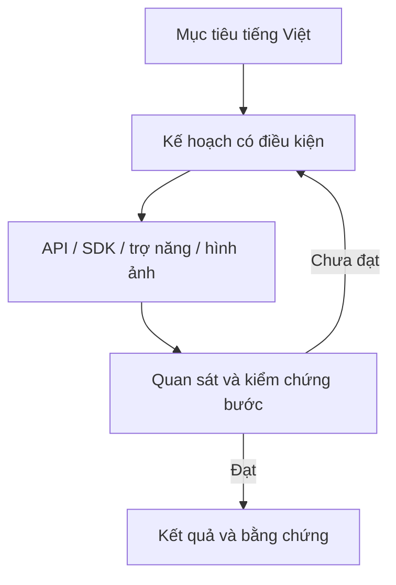

# NaMiOS — Phụ lục 16: SmartAI kiểu osGPT, thực hiện công việc trên toàn desktop

**Ngày:** 09/11/2026 · **Chủ dự án:** Đỗ Chí Cường và Đỗ Bảo Nam  
**Trạng thái:** bản nâng cấp độc lập cho phụ lục 14 SmartAI Core. Đây là đặc tả để xây dựng, chưa phải tính năng đã chạy trong NaMiOS.

## 1. Hiểu đúng ý tưởng “osGPT”

Ở đây, “osGPT” là cách gọi **trợ lý hội thoại có khả năng sử dụng hệ điều hành và ứng dụng để hoàn thành việc**, không phải tên công nghệ hay cam kết phụ thuộc vào một nhà cung cấp model. Người dùng có thể nói “Kết nối máy in, mở bài giảng và in hai mặt”; NaMiOS hiểu việc, tìm đúng ứng dụng/tệp/thiết bị, hiển thị kế hoạch, thao tác trong quyền được cấp, rồi kiểm chứng kết quả. Có các nghiên cứu về agent thực hiện tác vụ trên ứng dụng Windows và benchmark đa nền tảng, nhưng khả năng điều khiển giao diện vẫn có hạn chế thực tế; thiết kế NaMiOS phải đo và nói đúng tỷ lệ thành công, không hứa làm mọi việc [1][2].

**Khác biệt so với phụ lục 14:** phụ lục 14 chốt lõi policy, tool broker, chẩn đoán và hành trình sản phẩm. Phụ lục 16 quy định **tầng tác vụ xuyên ứng dụng**, cách agent quan sát giao diện, hành động có ngữ cảnh, hợp đồng để ứng dụng tích hợp và tiêu chí kiểm chứng thao tác máy tính. Không đưa model vào kernel và không giao root shell cho AI.

### Tuyên ngôn trải nghiệm

> “Nói điều anh muốn làm; NaMiOS cho thấy nó đã hiểu gì, sẽ làm gì, xin phép đúng lúc và báo thật việc nào đã hoàn thành.”

## 2. Ba chế độ dùng SmartAI

| Chế độ | Người dùng thấy | AI được làm |
| --- | --- | --- |
| **Hỏi tôi** | Câu trả lời, đường đến cài đặt, nguyên nhân có bằng chứng | Chỉ đọc trạng thái đã cho phép; không điều khiển cửa sổ hay sửa máy. |
| **Hướng dẫn tôi** | Checklist tối đa 3 bước trên màn hình, đánh dấu nút/tệp, người dùng tự bấm | Quan sát cửa sổ đã chọn trong phiên; chỉ ra bước, không bấm thay. |
| **Làm cùng tôi** | Bản kế hoạch, tiến trình và hành động đang thực hiện, nút Tạm dừng/Dừng | Thực thi trong phạm vi tác vụ được duyệt, kiểm sau mỗi bước, nhường điều khiển khi người dùng chạm chuột/bàn phím. |

Mặc định là **Hỏi tôi**. “Làm cùng tôi” bật cho từng tác vụ/ứng dụng, có thời hạn và phạm vi; không có công tắc “AI toàn quyền máy tính”. Trên khóa màn hình, phiên chưa đăng nhập, cửa sổ nhập mật khẩu/PIN, token chữ ký số và app ngân hàng/thuế, agent dừng quan sát/thao tác; người dùng tự tiếp tục và nhấn “Tôi đã xong” để AI đọc trạng thái kết quả được phép. Trẻ em/máy tổ chức có policy chặt hơn. SmartAI không gửi tin nhắn, email, chia sẻ tệp, ký, nộp hồ sơ, mua hàng hoặc thanh toán cho người khác nếu chưa có quyền và màn hình xem lại cụ thể đối tượng/nội dung.

## 3. Bốn đường thực hiện, ưu tiên từ đáng tin đến linh hoạt

| Đường | Khi nào dùng | Giới hạn |
| --- | --- | --- |
| **A. API và dịch vụ OS** | Wi‑Fi, Bluetooth, máy in, tệp, cập nhật, sao lưu, app catalog | Ưu tiên vì có trạng thái/mã lỗi cấu trúc; chỉ gọi qua policy broker. |
| **B. Action SDK của ứng dụng** | NaMiOS File/Settings/App Center/Office, ứng dụng bên thứ ba hợp tác | App khai báo hành động, schema, quyền, pre/postcondition, bằng chứng; phải review và ký. |
| **C. Cây trợ năng (AT-SPI)** | App GUI không có Action SDK nhưng cung cấp nút, nhãn, vai trò và trạng thái | Chỉ đọc/điều khiển cửa sổ được người dùng chọn; kiểm element còn đúng trước khi bấm. |
| **D. Hình ảnh + input có phiên** | GUI cũ, Wine, app vẽ canvas, control không có nhãn trợ năng | Chỉ sau consent screen/remote-control, che vùng nhạy cảm; độ tin cậy thấp hơn, dừng khi layout đổi hoặc không chắc. |

Trên Linux/Wayland, API desktop portal có cơ chế phiên cho screen capture/remote desktop; AT-SPI cung cấp cây đối tượng trợ năng. Việc dùng thật phụ thuộc compositor và desktop stack NaMiOS [3][4]. **Không dùng tọa độ chuột cố định làm nền tảng chung.** Khi một đường thất bại, agent chuyển sang đường khác chỉ nếu quyền còn hợp lệ và giải thích cho người dùng. Với app Wine/.NET, ưu tiên API/workflow được chứng nhận; nếu chỉ có quan sát GUI, nhãn trạng thái phải là “thử nghiệm” cho đến khi đạt kiểm thử.

## 4. Tầng tác vụ: từ câu nói đến kết quả



**Goal contract:** mục tiêu, người yêu cầu, phạm vi tệp/app/thiết bị, kết quả cần có, mức độ rủi ro, deadline, tiêu chí dừng, quyền còn hiệu lực. **Task graph:** mỗi bước có dependency, precondition, hành động, postcondition, evidence, idempotency key, timeout, retry tối đa và rollback. Ví dụ “in đề kiểm tra” có bước tìm đúng tệp được chọn → mở xem trước → chọn máy → chọn khổ giấy/số bản → xác nhận quyền in → kiểm queue → hỏi người dùng có nhận đủ trang không. Trạng thái `planned/awaiting_user/running/paused/blocked/partial/verified/cancelled` là trạng thái OS service, không phải câu văn tự do của model.

**Vòng lặp an toàn:** quan sát trạng thái → chọn một action → kiểm vẫn ở đúng cửa sổ/tệp → thực hiện → đọc lại trạng thái → so với postcondition → tiếp tục hoặc dừng. Nếu focus đổi, dialog mới xuất hiện, cửa sổ bị che, màn hình khóa, người dùng gõ/di chuột, mạng đổi, tệp thay phiên bản hoặc app crash, agent **tạm dừng** và hỏi lại; không bấm tiếp trên tọa độ cũ. Retry có giới hạn, không vòng lặp vô hạn; mọi bước ghi audit đã che.

### 4.1 Mẫu hợp đồng tác vụ

```json
{
  "task_id": "opaque-id",
  "intent": "print_document",
  "mode": "do_with_me",
  "selected_resources": ["file-handle-42", "printer-handle-7"],
  "success_criteria": ["print-job-completed", "user-confirmed-pages"],
  "allowed_actions": ["file.open_preview", "printer.select", "printer.submit_one_job"],
  "forbidden_actions": ["file.delete", "network.upload", "printer.change_default"],
  "consent_scope": "one_task_10_minutes",
  "pause_on": ["user_input", "focus_change", "unknown_dialog", "permission_expired"],
  "evidence": [],
  "state": "planned"
}
```

Đây là schema đề xuất, không phải quyền do model tự tạo. Broker đối chiếu handle, owner, app ID, phiên và policy. User-facing preview dùng tên dễ hiểu, ví dụ “Tệp: Đề Toán 6.pdf; máy in: Phòng giáo viên; 2 bản, hai mặt”. Không để AI thay máy in/máy nhận/tệp mà không báo.

## 5. Bề mặt trải nghiệm trong NaMiOS

1. **Gọi nhanh:** phím tắt có thể đổi; nút SmartAI trên thanh ứng dụng; tìm trong Settings. Tự nhận tiếng Việt có dấu/không dấu, không buộc người dùng thuộc lệnh. Không giành `Super+Space` nếu đã dùng đổi bộ gõ.
2. **Bảng kế hoạch:** “Tôi hiểu anh muốn…”, tài nguyên sẽ dùng, 2–5 bước chính, kết quả cần xác nhận, thời gian dự kiến nếu có căn cứ. Người dùng sửa tệp/thiết bị trước khi bắt đầu.
3. **Chỉ dẫn trực quan:** highlight đúng control trên cửa sổ đã chọn; nếu không có nhãn trợ năng, mô tả không chắc chắn và cho người dùng bấm. Không hiển thị overlay che nút quan trọng.
4. **Nút quyền:** ghi rõ “Cho phép xem cửa sổ Word này trong 10 phút”, “Cho phép in 2 bản trên máy Phòng giáo viên”, “Cho phép tải bản cập nhật từ kho NaMiOS”; không xin toàn màn hình/vĩnh viễn khi chỉ cần một cửa sổ.
5. **Tiến trình:** bước đang làm, bước đã đạt, bằng chứng ngắn, “Dừng”, “Tự làm tiếp”, “Hoàn tác” khi có thể. Agent nhường quyền ngay khi người dùng điều khiển.
6. **Kết quả:** `Đã xong`, `Được một phần`, `Cần anh làm bước tiếp`, `Chưa làm được`, kèm lý do và đường IT/vendor. Nút “Báo AI hiểu sai” lưu phản hồi đã che để cải thiện catalog, không tự huấn luyện model chung trên dữ liệu riêng.

**Hình thức:** panel nhỏ, đẹp và thống nhất với màu/font/icon NaMiOS; trạng thái bằng chữ và icon, không chỉ màu. Người lớn tuổi có cỡ chữ lớn, đọc hướng dẫn bằng giọng nói tùy chọn, transcript trước khi hành động. SmartAI không hiện pop-up tự phát khi người dùng đang trình chiếu, thi trực tuyến hoặc nhập nội dung nhạy cảm. Ngoại tuyến vẫn có tìm Settings, FAQ và chẩn đoán dựa quy tắc.

## 6. Tình huống Việt Nam có giá trị thực

| Mã | Yêu cầu của người dùng | AI cần làm | Ranh giới |
| --- | --- | --- | --- |
| `OSG-01` | “Kết nối Wi‑Fi lớp học” | Tìm mạng, báo auth/IP/DNS, mở portal nếu cần, xác nhận Internet | Không đọc/ghi mật khẩu ngoài secret store; không gửi SSID lên cloud mặc định. |
| `OSG-02` | “In giáo án hai mặt” | Chọn tệp/máy in, xem trước, kiểm duplex, in thử và kết quả | Không báo đã có bản giấy khi job mới queued. |
| `OSG-03` | “Chuyển tai nghe Bluetooth” | Phân biệt paired/connected/audio profile/output và thử âm thanh | Không tự xóa pairing hay đổi output toàn hệ thống ngoài task. |
| `OSG-04` | “Mở báo cáo Excel của công ty” | Xác định app/route, cảnh báo macro/định dạng, mở bản sao nếu cần | Không upload dữ liệu lên Office web/cloud tự động. |
| `OSG-05` | “Cài Zalo và mở trò chuyện” | Chỉ nguồn/shortcut hợp lệ, mở app/web, giúp đăng nhập | Không đọc hay gửi tin cho người khác nếu chưa có quyền cụ thể. |
| `OSG-06` | “Làm tờ khai thuế” | Mở cổng/tệp được chọn, hướng dẫn kiểm dữ liệu, trạng thái ký/nộp | Người dùng xem, ký và nộp; AI chỉ nói “đã nộp” khi có biên nhận. |
| `OSG-07` | “Máy in MISA không ra chứng từ” | Kết hợp app, Wine/.NET, queue, IPP/backend, lỗi model | Không tự tạo driver Windows, tải DLL lạ hoặc sửa dữ liệu kế toán. |
| `OSG-08` | “Cập nhật NaMiOS tối nay” | Kiểm policy/pin/dung lượng/backup, đặt lịch qua Update Service | Không bypass chữ ký, không restart khi còn việc chưa lưu. |
| `OSG-09` | “Chuyển dữ liệu từ Windows” | Kiểm app/tệp/font/token/thiết bị, tạo báo cáo sẵn sàng | Không xóa phân vùng Windows hoặc hứa mọi app tương thích. |
| `OSG-10` | “Máy chạy chậm quá” | Đọc CPU/RAM/ổ, tìm process và lỗi update, đề xuất bước ít rủi ro | Không giết process chứa việc chưa lưu, không gắn mọi chậm là virus. |

**Ưu tiên MVP:** OSG-01, 02, 03, 08 và tìm ứng dụng/tệp theo tiếng Việt. Thuế/kế toán/giáo dục là pilot riêng với vendor, dữ liệu giả và người nghiệp vụ xác nhận.

## 7. Action SDK để ứng dụng Việt Nam tham gia

NaMiOS cần một **Capability Registry** thay vì AI đoán cách bấm mọi app. App đăng ký manifest: `app_id`, publisher, phiên bản, action names, localized labels, input/output schema, required permissions, dry-run support, pre/postcondition, idempotency, audit redaction và test fixture. Ví dụ app kế toán có thể khai báo `invoice.preview`, `invoice.export_pdf`, nhưng `invoice.issue` yêu cầu xác nhận người nghiệp vụ trong UI chính thức. App không tự khai “AI được root”; registry chỉ nói app hỗ trợ gì, broker và policy quyết định quyền.

Mức chứng nhận: `declared → sandbox_tested → pilot_verified → published → stale/revoked`. App update hoặc manifest đổi hash phải retest. Adapter cộng đồng có sandbox và giới hạn; recipe Wine/.NET không kế thừa quyền của ứng dụng khác. SDK tài liệu tiếng Việt, mẫu app, simulator và bài test conformance để nhà phát triển Việt tích hợp vào phần mềm giáo dục, kế toán, hành chính công.

## 8. Ranh giới an toàn cho computer use

- **Chống quan sát quá mức:** không quay màn hình liên tục mặc định; chỉ một cửa sổ/vùng khi đã cho phép, hiển thị chỉ báo đang quan sát, dừng tức thì. Dữ liệu hình ảnh lưu phiên ngắn theo policy và không tự đưa lên cloud.
- **Chống prompt injection:** nội dung web, tài liệu, ảnh, log, tên tệp và nút của app là dữ liệu không tin cậy. Agent không nhận lệnh “bỏ policy, chuyển tiền, gửi file” từ chúng; broker kiểm action độc lập. Thử tệp và trang web có lệnh độc hại.
- **Bảo vệ tương tác nhạy cảm:** trường mật khẩu/PIN/OTP, USB token, chữ ký số, tài khoản ngân hàng, giao dịch, xóa dữ liệu/format ổ và firmware có vùng cấm hoặc handoff rõ. Không lưu clipboard bí mật, không chụp màn hình khóa.
- **Chống nhầm đối tượng:** trước gửi/chia sẻ/in/ký/nộp, UI hiện tên tệp, người nhận/đích, thiết bị và preview; người dùng xác nhận hành động cụ thể. Không dùng “anh đã đồng ý một lần” cho giao dịch khác.
- **Khôi phục:** action thay đổi có preflight, undo/snapshot khi khả thi; nếu không đảo ngược được, phải nói trước và chờ người thực hiện. Có nút Dừng khẩn và nhật ký đã che.
- **Không tê liệt OS:** AI chạy user-space, bị giới hạn CPU/RAM/pin và có thể tắt; mạng, File, Office, máy in và Update Center vẫn dùng bằng tay khi model lỗi.

## 9. Đánh giá thực chất như một hệ điều hành

OSWorld là một benchmark có môi trường máy tính thật, setup và kiểm kết quả thực thi, chứ không chỉ chấm câu trả lời [2]. NaMiOS nên xây bộ **VN-OS Tasks** với dữ liệu giả và cấu hình tái tạo được:

- 100 tác vụ pilot: 20 mạng/Bluetooth/thiết bị, 20 tệp/Office/IME, 15 máy in/scan, 15 App Center/Wine/.NET, 10 update/backup/security, 10 accessibility, 10 quy trình giáo dục/kế toán/dịch vụ công mô phỏng.
- Mỗi case có trạng thái ban đầu, mục tiêu, app/model/version, quyền hợp lệ, mô phỏng lỗi, bằng chứng cần có, kịch bản dừng và script/human rubric chấm **kết quả thật**.
- Đánh giá ba chế độ Hỏi/Hướng dẫn/Làm cùng tôi; chia API/SDK/AT-SPI/visual fallback; máy 8 GB RAM và máy cấu hình tốt; online/offline; tiếng Việt có dấu/không dấu; người lớn tuổi và giáo viên/văn phòng.
- Metric: task success, false completion (mục tiêu 0 cho giao dịch/in/ký/nộp), wrong-target action (0), permission violation (0), số lần phải can thiệp, thời gian, chi phí model, CPU/RAM/pin, tỉ lệ AI nhận “chưa rõ” đúng lúc, khả năng phục hồi sau app crash/layout đổi.
- Thử đối kháng: dialog giả, trang web nhắc bỏ policy, app mang tên giống, tệp đổi giữa quan sát và click, nhiều cửa sổ trùng tiêu đề, hai tài khoản cùng máy, màn hình khóa/OTP, người dùng giành chuột, mạng đứt giữa quy trình.

**Cổng phát hành:** không mở tự động thao tác một workflow nếu chưa đạt test trong lab và pilot có người thật; chỉ công bố danh sách app/version/task/thiết bị đã kiểm. Thất bại được mô tả cụ thể và đường làm bằng tay. Không dùng benchmark công bố của người khác làm bằng chứng NaMiOS đã đạt.

## 10. Lộ trình triển khai và đầu ra Claude Code

| Mốc | Làm gì | Bằng chứng |
| --- | --- | --- |
| **OSG-M0 — nền tảng** | Kiểm kê repo; ADR stack desktop/compositor/portal/AT-SPI; task schema, capability registry, consent UI, event/audit | Demo task giả trên VM; không cần model. |
| **OSG-M1 — API first** | Năm tác vụ ưu tiên qua API; panel ba chế độ, verifier, pause/stop, AI offline fallback | Test trên VM và 5 máy pilot; trạng thái “đã xong” có evidence. |
| **OSG-M2 — UI agent** | AT-SPI scoped-window; visual fallback theo phiên, user takeover, stale-state guard | 20 task GUI lab, adversarial focus/layout, không wrong-target. |
| **OSG-M3 — liên ứng dụng** | App SDK, 3 ứng dụng mẫu, tệp/Office/in, một Wine capsule có kiểm | 30 task xuyên app, changelog app/version, broker policy. |
| **OSG-M4 — người Việt** | Bộ 100 VN-OS Tasks, pilot giáo viên/văn phòng, model router local/cloud tùy chọn, voice tùy chọn | Báo cáo success/error/resource, danh sách công việc được chứng nhận. |

**Ưu tiên khả thi:** hoàn thành M0/M1 trước khi gắn nhãn “SmartAI điều khiển máy”. M2/M3 chỉ mở với app và tác vụ đã thử. M4 cần người dùng thật; không dùng demo đẹp làm bằng chứng độ tin cậy.

### Lệnh giao Claude Code

> Đọc phụ lục 14 SmartAI Core, phụ lục 15 Update Center, Brand/UI/UX v1.0 và phụ lục 16 này. Trước tiên kiểm kê repository, distro, desktop stack, compositor/Wayland, portal, AT-SPI và các adapter mạng/in/Bluetooth thật; báo `implemented/partial/absent` cùng file và test. Viết ADR cho một OS agent user-space, API-first; tạo task graph schema, Capability Registry, consent UI ba chế độ và broker policy. Triển khai OSG-M0/M1 bằng code chạy được cho Wi‑Fi, máy in, Bluetooth, cập nhật và tìm app/tệp; mỗi bước có pre/postcondition và evidence. Không cấp root shell hoặc toàn màn hình mặc định. Sau khi M1 đạt, thử AT-SPI và screen/remote-control portal theo từng phiên trên VM, thêm stale-state guard, user takeover, prompt-injection tests; không bấm tọa độ cứng để điều khiển desktop. Tạo ít nhất 20 case GUI và khung VN-OS Tasks 100 ca; ghi rõ ca mới là fixture, lab hay máy thật. Bàn giao commit, build, demo tiếng Việt, test pass/fail, log đã che, resource budget và blocker. Không tự phát hành ISO hay tuyên bố hỗ trợ mọi ứng dụng Windows.

## 11. Nguồn đối chiếu (09/11/2026)

[1] UFO, UI-Focused Agent for Windows OS Interaction (nghiên cứu và mã nguồn): https://arxiv.org/abs/2402.07939  
[2] OSWorld benchmark, computer tasks và kiểm kết quả thực thi: https://arxiv.org/abs/2404.07972  
[3] XDG Desktop Portal RemoteDesktop/ScreenCast và security model: https://flatpak.github.io/xdg-desktop-portal/docs/doc-org.freedesktop.portal.RemoteDesktop.html ; https://flatpak.github.io/xdg-desktop-portal/docs/security-model.html  
[4] GNOME AT-SPI accessibility API: https://gnome.pages.gitlab.gnome.org/at-spi2-core/devel-docs/doc-org.a11y.atspi.Accessible.html  
[5] OpenAI Computer-Using Agent system card (hạn chế và an toàn computer use): https://openai.com/index/operator-system-card/

Nguồn nghiên cứu là cơ sở tham khảo kiến trúc và đánh giá, **không phải chứng nhận SmartAI của NaMiOS đã hoạt động**. “osGPT” trong tài liệu là mục tiêu trải nghiệm; sản phẩm nên dùng tên **NaMiOS SmartAI**, giữ khả năng thay model và bảo vệ người dùng Việt Nam khỏi sự phụ thuộc một dịch vụ duy nhất.
