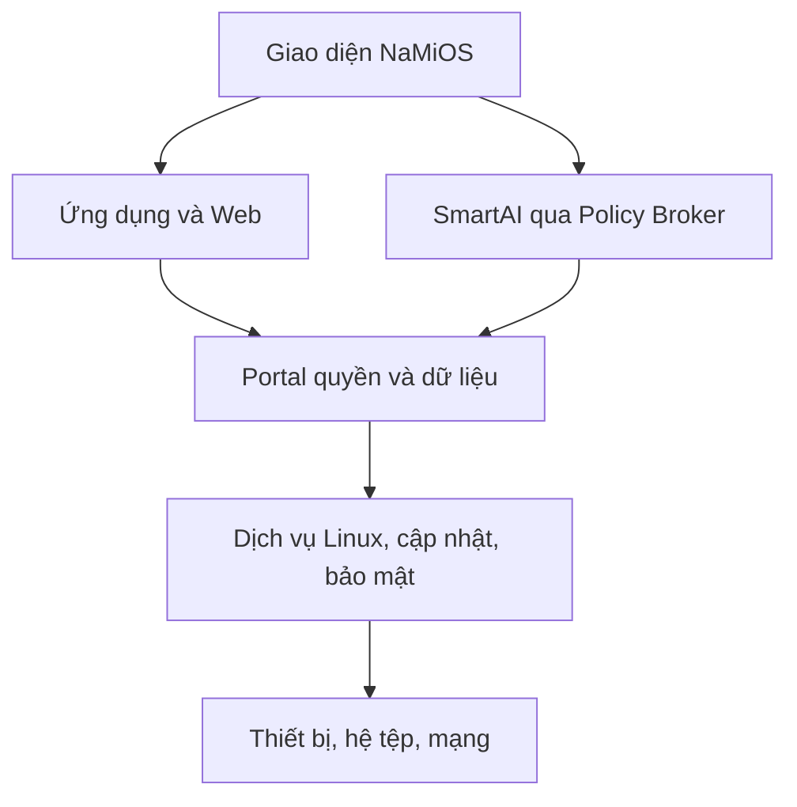

# NaMiOS — Phụ lục 09: Trải nghiệm người Việt, ứng dụng mặc định và an toàn vận hành

**Ngày:** 06/11/2026. **Chủ dự án:** Đỗ Chí Cường và Đỗ Bảo Nam.  
**Loại:** đặc tả bổ sung độc lập, mã `VN09-001`–`VN09-048`; không thay các phụ lục trước. **Đối tượng triển khai:** Claude Code, nhóm thiết kế, bảo mật, kiểm thử và đối tác thử nghiệm.

## 1. Quyết định sản phẩm và giới hạn tuyên bố

NaMiOS sử dụng nền Linux và các thành phần nguồn mở phù hợp, bổ sung lớp trải nghiệm, bảo mật, SmartAI và kiểm chứng tương thích. Mục tiêu là một máy tính thân thiện với người Việt: mở máy là gõ được tiếng Việt, đọc/in tài liệu, dùng mạng và ứng dụng quen thuộc, biết rõ khi có rủi ro. Thẩm mỹ cần tinh tế, mạch lạc, phản hồi mượt theo tinh thần sản phẩm Apple, nhưng dùng thiết kế, biểu tượng, tên và tài sản thương hiệu **nguyên bản** của NaMiOS; không sao chép giao diện macOS hoặc tạo ấn tượng được Apple chứng nhận. Giữ các luồng quen thuộc: màn hình chính, nút ứng dụng, khay trạng thái, phím tắt, kéo thả, quản lý tệp, chuột phải, nhiều cửa sổ.

“Cài sẵn” phải phân biệt ba loại: (A) ứng dụng Linux cài trong ảnh hệ thống; (B) lối mở trang chính thức, có thể cài thành web app khi trình duyệt hỗ trợ; (C) ứng dụng Windows chạy trong capsule Wine **chỉ sau khi được kiểm thử theo phiên bản và nghiệp vụ**. Không gán loại B là app Linux native, không quảng cáo offline nếu dịch vụ cần mạng. Nhà cung cấp quyết định giấy phép, đăng nhập, phạm vi truy cập, DRM và khả năng hỗ trợ; NaMiOS không đại diện họ.

| Nhu cầu | Mặc định ban đầu | Trạng thái cần ghi trên UI |
| --- | --- | --- |
| Facebook | Lối mở chính thức `https://www.facebook.com/` qua trình duyệt; web app tùy khả năng | “Dịch vụ web; cần mạng và tài khoản riêng”. |
| Zalo | Lối mở bản Web từ `https://www.zalo.me/pc`/`https://id.zalo.me/`; kiểm thử luồng chat, file, thông báo | “Zalo Web”; bản PC Windows chỉ là tuyến Wine có chứng nhận, không có cam kết Linux native [1][2]. |
| TikTok | Lối mở `https://www.tiktok.com/` | “Dịch vụ web”; kiểm quyền camera/mic/upload. |
| YouTube | Lối mở `https://www.youtube.com/` | “Dịch vụ web”; kiểm codec/DRM theo trình duyệt và nội dung. |
| Gõ tiếng Việt | Bộ gõ hệ thống native, Telex/VNI/Unicode | Hoạt động cả trong ứng dụng Linux, Web và ứng dụng Windows đã kiểm thử. |
| Bảo vệ máy | NaMiOS Security Center + công cụ quét mã độc được duy trì | Báo trạng thái thực, ngày cập nhật và giới hạn; không hứa ngăn 100% mã độc. |

Các lối mở được ghim sẵn trên màn hình “Ứng dụng phổ biến” và có thể bỏ ghim/gỡ khỏi hồ sơ. Không tự đăng nhập, không đóng gói cookie/mật khẩu, không gửi dữ liệu cho mạng xã hội khi người dùng chưa mở dịch vụ. Không nhúng wrapper bên thứ ba yêu cầu mật khẩu. Logo/tên của bên thứ ba chỉ dùng theo quy định thương hiệu và bản phát hành cần rà soát pháp lý. Trình duyệt có cơ chế cài web app, nhưng tính năng offline phụ thuộc ứng dụng web [3].

## 2. Kiến trúc tham chiếu và hợp đồng

Thiết kế này không đặt model AI trong đường xử lý boot, gõ phím, cấp quyền hệ thống hoặc quyết định một file “sạch”. SmartAI giải thích, hướng dẫn, chẩn đoán và đề xuất hành động qua công cụ có quyền hạn và dấu vết; các bộ kiểm tra xác định và chính sách bảo mật ra quyết định.

### 2.1 Ngôn ngữ, khả năng tiếp cận, nhập liệu

**VN09-001 P0 — Bản địa hóa tiếng Việt.** 100% luồng cài đặt, đăng nhập, thiết lập, cập nhật, cứu hộ, Security Center và lỗi mức người dùng có tiếng Việt chuẩn; thuật ngữ nhất quán `Tệp`, `Ứng dụng`, `Máy in`, `Khôi phục`. Giữ English tùy chọn. **Nghiệm thu:** rà soát 30 luồng bởi người dùng Việt, không có chuỗi chưa dịch/cắt chữ ở độ phân giải pilot.

**VN09-002 P0 — Bộ gõ hệ thống.** Dùng framework nhập liệu Linux được phân phối hỗ trợ; Telex, VNI, Unicode dựng sẵn, Unicode tổ hợp khi cần, tự do bật/tắt và lưu theo người dùng. Không tự chế giao thức keyboard toàn hệ thống. **Nghiệm thu:** bộ ca văn bản tiếng Việt có dấu, sửa dấu, xóa/backspace, chọn đoạn và clipboard trong app GTK/Qt, browser, Office và mẫu Wine.

**VN09-003 P0 — Không gõ hai lần.** Test với Wayland/XWayland, remote desktop, Wine prefix, trình duyệt, ô tìm kiếm và ô mật khẩu; lưu ngoại lệ theo app/version nếu engine không giải quyết được. Không đọc hay log phím trong ô bí mật. **Nghiệm thu:** 200 lượt nhập mỗi loại không lặp ký tự/mất dấu; lỗi có case tái hiện.

**VN09-004 P1 — Quy ước Việt Nam.** Mặc định múi giờ Asia/Ho_Chi_Minh, ngày `dd/MM/yyyy`, đồng Việt Nam theo locale, tuần bắt đầu thứ Hai khi phù hợp; không tự suy nội dung số tiền/thuế. **Nghiệm thu:** tệp CSV `1.234,56` và `1,234.56` phải hỏi hoặc hiện preview trước nhập, không âm thầm đổi giá trị.

**VN09-005 P0 — Font và tương thích tài liệu.** Gói font Unicode tiếng Việt có giấy phép phân phối, font thay thế có bảng mapping rõ; cảnh báo thiếu font với tài liệu DOCX/PDF thay vì âm thầm thay bố cục. **Nghiệm thu:** 20 biểu mẫu tiếng Việt in ra không mất dấu; khác biệt dòng/trang được đánh dấu.

**VN09-006 P1 — Tiếp cận.** Tăng cỡ chữ, contrast cao, giảm chuyển động, điều khiển bàn phím, screen reader, phóng to, captions và chỉ báo focus; tiếng Việt cho nhãn accessibility. **Nghiệm thu:** hoàn thành đăng nhập, kết nối Wi‑Fi, cài app và in test bằng bàn phím; không dựa riêng vào màu.

**VN09-007 P1 — Tìm kiếm và trợ giúp bằng lời thường.** Tìm app, cài đặt, tệp thuộc quyền và hướng dẫn bằng tiếng Việt không dấu/có dấu; SmartAI chỉ tìm nội dung tệp sau khi người dùng cấp phạm vi. **Nghiệm thu:** “may in”, “máy in”, “ket noi wifi” dẫn tới cùng tác vụ; không lộ tệp tài khoản khác.

### 2.2 Giao diện và trải nghiệm hoàn thiện

**VN09-008 P0 — NaMi Design System.** Token màu, typography, khoảng cách 4/8 px, radius, shadow, icon, tương tác, trạng thái lỗi/loading/disabled, dark/light và scale; tài sản nguyên bản, có kiểm tương phản. **Nghiệm thu:** bốn màn hình Settings, File, Security, App Center dùng cùng token; audit contrast WCAG 2.2 AA cho chức năng chính [4].

**VN09-009 P0 — Desktop quen thuộc.** Launcher tìm kiếm, thanh ứng dụng có ghim, danh sách cửa sổ, khay mạng/âm thanh/pin/IME, thông báo, đồng hồ; cho chọn thanh dưới hoặc dock tinh gọn. Nút đóng/thu nhỏ/phóng to, Alt+Tab, Super, Ctrl+C/V, file association hoạt động nhất quán. **Nghiệm thu:** 8/10 người pilot đã dùng Windows tự mở Zalo Web, đổi Wi‑Fi, tìm file, in tài liệu mà không cần chỉ dẫn quá một lần.

**VN09-010 P1 — Chuyển đổi êm.** Màn hình chào 5 bước: ngôn ngữ/IME → mạng → tài khoản và bảo vệ → nhập tệp → chọn ứng dụng ghim; cho bỏ qua, trở lại, giải thích riêng tư. Không chuyển mật khẩu/cookie từ Windows. **Nghiệm thu:** mất mạng giữa onboarding vẫn vào desktop và hoàn tất sau.

**VN09-011 P0 — File Manager.** Thư mục quen thuộc, breadcrumb, tìm kiếm, preview an toàn, sao chép có tiến trình/checksum khi cần, undo chuyển tệp/thùng rác, đổi tên hàng loạt có preview, USB eject, mạng SMB với quyền. **Nghiệm thu:** copy USB bị rút báo rõ file nào chưa xong, bản gốc còn; không chạy file tải về khi preview.

**VN09-012 P1 — Mẫu giao diện ứng dụng.** Cửa sổ đầu tiên dưới 2 giây trên cấu hình chuẩn đề xuất sau khi đo; skeleton khi mạng chậm; nút chính một hành động; lỗi có “Thử lại”, “Xem chi tiết”, mã lỗi. **Nghiệm thu:** benchmark cold/warm được lưu theo máy; tuyệt đối không hiện trạng thái “đã gửi/đã in” nếu chưa có biên nhận/job thành công.

**VN09-013 P1 — Quản lý thông báo.** Tách bảo mật, công việc và marketing; im lặng theo giờ, gộp thông báo trùng, xem lịch sử, privacy trên màn hình khóa. **Nghiệm thu:** 20 lỗi mạng giống nhau tạo một nhóm; không hiện tên tài liệu/khoản tiền trên màn hình khóa.

**VN09-014 P1 — Hiệu ứng tiết chế.** Animation 120–250 ms theo thiết kế sau test, giảm hiệu ứng ở máy yếu/chế độ accessibility, không chặn tác vụ vì animation. **Nghiệm thu:** cuộn danh sách 1.000 tệp không đóng băng; chế độ reduce motion bỏ hiệu ứng không cần thiết.

**VN09-015 P0 — Lỗi có đường thoát.** Giao diện nêu nguyên nhân đã biết, bước thử an toàn, nút hoàn tác/khôi phục, tùy chọn xem log đã che cho IT. **Nghiệm thu:** cài app lỗi, mất mạng, quên máy in mặc định đều xử lý được từ màn hình trạng thái.

### 2.3 Ứng dụng mặc định và phân phối

**VN09-016 P0 — Manifest ứng dụng mặc định.** Mỗi mục có `app_id`, loại A/B/C, nhà cung cấp, URL chính thức hoặc repo, hash/signature gói nếu áp dụng, giấy phép, quyền, kích thước, có/không offline, lịch kiểm lại và người phụ trách. **Nghiệm thu:** không mục nào có tên “đã cài” khi chỉ là web shortcut.

**VN09-017 P0 — Gói thiết yếu native.** Browser được vá bảo mật, file manager, xem PDF, ảnh/video cơ bản, Office bundle đã chọn ở phụ lục 07, IME, Settings, App Center, Print/Scan Center, Security Center, Backup/Restore và SmartAI UI. Ứng dụng email tùy chọn. **Nghiệm thu:** dùng được file DOCX/XLSX/PDF cơ bản và in test khi không có tài khoản mạng xã hội; nghiệm thu tương thích tài liệu theo bộ test riêng.

**VN09-018 P0 — Shortcut chính thức.** Facebook, Zalo Web, TikTok, YouTube mở URL HTTPS trong browser profile được bảo vệ; kiểm hostname allowlist, không pin trang đăng nhập giả, cập nhật URL qua manifest ký. Chuyển hướng được xác minh, báo người dùng nếu khác domain kỳ vọng. **Nghiệm thu:** URL thay bằng `zalo-login.example` bị chặn/cảnh báo; shortcut gỡ được.

**VN09-019 P1 — Web app nếu khả dụng.** Cho người dùng chọn mở như tab hay cửa sổ riêng, quản lý thông báo/camera/mic/file theo site, nêu rõ cần internet. Không ép mọi site thành PWA nếu site/browser không cung cấp khả năng. **Nghiệm thu:** bỏ quyền thông báo Zalo không làm mất quyền duyệt web; xóa web app không xóa tài liệu local.

**VN09-020 P0 — Zalo thực tế.** Test Zalo Web theo login QR, nhắn tin, tải/gửi file, download, Unicode, notification và phiên hết hạn; lập ma trận Web và Windows PC qua Wine theo phiên bản, ghi rõ tính năng thiếu. **Nghiệm thu:** app PC Wine không được nhãn “hỗ trợ” nếu call, chia sẻ màn hình hoặc gửi file quan trọng chưa qua test.

**VN09-021 P1 — Ứng dụng xã hội tùy hồ sơ.** Hồ sơ cá nhân/văn phòng/trường học có ghim mặc định khác nhau; quản trị tổ chức có thể ẩn dịch vụ giải trí nhưng không cấm người dùng cá nhân tùy chỉnh. Không bloatware cài nền. **Nghiệm thu:** cài máy văn phòng không tự mở Facebook/TikTok và không truyền dữ liệu đến các domain này trước khi dùng.

**VN09-022 P0 — App Center có tin cậy.** Nguồn distro, kho kiểm duyệt, vendor chính thức, web shortcut và app Windows được phân loại rõ. Hiển thị quyền, nguồn, version, ngày cập nhật, mức hỗ trợ và khả năng gỡ. **Nghiệm thu:** gói không có provenance hoặc chữ ký không hợp lệ không thể hiện như app tin cậy.

**VN09-023 P1 — Người dùng kiểm soát mặc định.** Chọn browser, PDF viewer, Office, ảnh, nhạc và handler liên kết; export/import danh sách ghim mà không chứa phiên đăng nhập. **Nghiệm thu:** đổi mặc định DOCX rồi double-click mở đúng app; reset giữ file cá nhân.

### 2.4 Bảo mật và chống mã độc theo nhiều lớp

**VN09-024 P0 — Mô hình đe dọa.** Bao gồm phishing Zalo/Facebook, tệp tải về, USB, macro Office, gói độc, Wine `.exe`, lạm dụng quyền AI, ransomware, tài khoản mất máy, cập nhật bị can thiệp và thiết bị mạng không tin cậy. Mỗi đe dọa có điều khiển phòng ngừa, phát hiện, phục hồi và ca kiểm thử. **Nghiệm thu:** threat model được cập nhật mỗi release; ghi rủi ro còn lại và owner.

**VN09-025 P0 — Mặc định quyền tối thiểu.** Tài khoản thường không có root; GUI cài đặt/cấu hình yêu cầu xác thực cho hành động đặc quyền; ứng dụng có sandbox và portal file/camera/mic/USB khi khả thi. Không cấp `home`/system bus rộng theo mặc định cho Flatpak [5]. **Nghiệm thu:** app mẫu không được quyền không đọc thư mục tài chính hay USB token.

**VN09-026 P0 — Cập nhật tin cậy.** Nguồn gói được ký, kiểm metadata và phiên bản; OS, browser, engine quét, chữ ký phát hiện và firmware có vòng đời, ring pilot/stable và lịch vá theo mức nghiêm trọng. Hỗ trợ rollback bản hệ thống đã test. **Nghiệm thu:** gói bị đổi hash/chữ ký bị từ chối; update mất điện khởi động được bản trước hoặc recovery.

**VN09-027 P0 — Trình duyệt an toàn.** Bản vá đúng hạn, isolation theo site, chặn download nguy hiểm theo chính sách, báo URL mạo danh, kiểm certificate và permission site; người dùng xem/revoke quyền. Không tự tắt cảnh báo browser vì app tương thích. **Nghiệm thu:** mẫu domain giả, file tải nguy hiểm và site yêu cầu mic không có consent được xử lý đúng.

**VN09-028 P0 — USB và file lạ.** Không autorun/autoexecute; quét tùy chính sách khi mount hoặc trước mở file có rủi ro, kiểm loại file thực và đuôi kép, cảnh báo file `.exe`, script, macro, shortcut đáng ngờ; mount an toàn khi hệ tệp lỗi. **Nghiệm thu:** `Hoa_don.pdf.exe` không chạy qua preview; USB vào máy không tự thực thi.

**VN09-029 P0 — Scanner bổ trợ.** Tích hợp engine scanner Linux đang được duy trì, ví dụ ClamAV, với cập nhật signature, on-demand scan, vùng cách ly, exclusions có quyền, lịch sử và khôi phục false positive. On-access scanning chỉ bật sau benchmark, kiểm giới hạn kernel/engine và chống deadlock/giảm tốc [6]. **Nghiệm thu:** bộ mẫu kiểm thử an toàn giả lập phát hiện/không phát hiện theo kỳ vọng; không quảng cáo mức bảo vệ 100%.

**VN09-030 P0 — Phân biệt phòng vệ với quét.** Security Center tổng hợp trạng thái cập nhật, quyền, firewall, bảo vệ browser, quét, backup và mã hóa; màu xanh chỉ khi từng chỉ báo đạt. Không lấy “quét sạch” làm bằng chứng máy không bị xâm nhập. **Nghiệm thu:** signature quá hạn, backup thất bại hoặc firewall tắt đều được báo riêng.

**VN09-031 P0 — Bảo vệ dữ liệu khỏi Wine.** Mỗi Windows app dùng prefix/capsule riêng và chỉ mount thư mục cần cho tác vụ; không map toàn bộ home mặc định. Mã độc Windows có thể thao tác trên tệp mà Wine được cấp, vì thế scanner không thay sandbox và backup. **Nghiệm thu:** mẫu `.exe` thử đọc thư mục không cấp quyền bị từ chối; file được cấp vẫn ghi nhận rủi ro và backup.

**VN09-032 P0 — Backup và chống ransomware.** Sao lưu theo phiên bản, có bản lưu tách quyền ghi thường ngày, kiểm phục hồi định kỳ; phát hiện biến động tệp hàng loạt bằng quy tắc xác định có ngưỡng false positive, tạm dừng tiến trình khả nghi theo policy rồi hỏi người dùng/IT. Không dựa duy nhất vào SmartAI. **Nghiệm thu:** bài test mã hóa hàng loạt cô lập được tiến trình trước ngưỡng mất dữ liệu do pilot định nghĩa, khôi phục 10 tệp đúng hash.

**VN09-033 P1 — Mã hóa và boot.** Hỗ trợ mã hóa ổ khi cài mới với recovery key giải thích và lưu an toàn do người dùng quyết định; kiểm Secure Boot khi phần cứng/phân phối hỗ trợ, tránh khóa người dùng khỏi máy. **Nghiệm thu:** mất thiết bị thử nghiệm không đọc được dữ liệu; bài test mất khóa có hướng dẫn thực tế, không hứa khôi phục nếu không còn khóa.

**VN09-034 P0 — Firewall mạng.** Mặc định không mở dịch vụ nhận từ Internet, phân loại mạng nhà/cơ quan/công cộng; luồng chia sẻ file/in cần bật có chủ đích và hiện cổng/đối tượng. **Nghiệm thu:** quét từ máy khác ở mạng công cộng không thấy dịch vụ chia sẻ đã tắt.

**VN09-035 P0 — Quyền SmartAI và riêng tư.** AI không đọc màn hình, tài liệu, clipboard, email hoặc phím gõ thường trực; tác vụ cần nội dung phải chỉ rõ nguồn, thời hạn, mục đích, xử lý local/cloud và cách xóa. Mọi lệnh cài package, sửa firewall, xóa/quarantine tệp đi qua Policy Broker, audit, xác nhận có ngữ cảnh và undo khi khả thi. **Nghiệm thu:** prompt injection trong trang web không khiến AI chạy lệnh đặc quyền hoặc tải binary.

**VN09-036 P1 — Telemetry chủ động.** Mặc định chỉ log kỹ thuật tối thiểu tại máy, ẩn tên tệp/nội dung/token; gửi báo cáo ra ngoài theo opt-in, preview và xóa. Tổ chức có retention rõ. **Nghiệm thu:** log crash của Zalo Web không có cookie, nội dung chat, đường dẫn cá nhân đầy đủ.

### 2.5 “Ít lỗi”: chất lượng, cứu hộ, đo lường

**VN09-037 P0 — Ảnh hệ thống có thể phục hồi.** Cập nhật theo giao dịch/snapshot phù hợp nền distro đã chọn, boot entry trước, recovery mode, rollback không xóa home và cảnh báo schema dữ liệu app không đảo ngược. **Nghiệm thu:** giả lập ngắt điện 3 thời điểm trong update, máy vào được OS hoặc recovery và biết bản đang chạy.

**VN09-038 P0 — Giới hạn tài nguyên.** Browser/Web app, Wine capsule, scanner và SmartAI có ngân sách CPU/RAM/IO và timeout; ưu tiên bàn phím, UI, in ấn, thao tác lưu file. **Nghiệm thu:** quét USB + AI đang xử lý không làm mất ký tự gõ và không khiến ứng dụng kế toán bị kill không thông báo.

**VN09-039 P0 — Crash và tương thích có bằng chứng.** Ghi crash ID, app/version, kernel, driver, recent update (đã che riêng tư); gắn vào hồ sơ thiết bị và chứng nhận app theo phụ lục 08. **Nghiệm thu:** một regression in trên kernel mới được nhận diện và chặn ring stable; không suy crash trong app là lỗi OS khi chưa điều tra.

**VN09-040 P0 — Kiểm thử hồi quy theo hành trình.** Mỗi bản phát hành chạy 15 hành trình: cài mới, boot/login, IME, Wi‑Fi, Ethernet, Bluetooth, USB, file, browser/video, Zalo Web, Office, PDF, in/scan, update/rollback, backup/restore; thêm .NET/Wine theo ma trận đã chứng nhận. **Nghiệm thu:** không phát hành nếu một hành trình P0 trên phần cứng chứng nhận fail.

**VN09-041 P1 — Kênh thử nghiệm và hỗ trợ.** Canary nội bộ → pilot người Việt nhiều nhóm tuổi/ngành → stable; bộ checklist máy có hỗ trợ, FAQ tiếng Việt, mã lỗi có đường gửi báo cáo tùy chọn. **Nghiệm thu:** mỗi lỗi nghiêm trọng có người phụ trách, mức độ, cách tái hiện, thời gian phản hồi và bản sửa hoặc workaround.

**VN09-042 P0 — Chỉ số chấp nhận.** Trong pilot đo tỷ lệ boot thành công, crash/100 giờ, cập nhật thất bại, phục hồi thành công, độ trễ IME, mở app, in/scan, false positive scanner và 8 tác vụ người dùng. Đặt ngưỡng release bằng dữ liệu pilot ban đầu và ghi số mẫu/cấu hình; không tự công bố số “99,9%” thiếu bằng chứng. **Nghiệm thu:** dashboard nêu mẫu số, khoảng thời gian và version.

**VN09-043 P1 — Quy trình hỗ trợ người mới.** Chẩn đoán theo “không vào mạng”, “không in”, “không gõ tiếng Việt”, “ứng dụng không mở”; nút thử an toàn, giải thích dễ hiểu, gửi IT khi không giải được. **Nghiệm thu:** người mới xác định hướng xử lý trong thử nghiệm có quan sát, không cần dòng lệnh.

### 2.6 SmartAI làm “linh hồn” nhưng có trách nhiệm

**VN09-044 P0 — Trợ lý việc làm.** Đầu vào lời nói/văn bản tiếng Việt, phân rã nhiệm vụ và hiển thị trước thao tác; các mẫu: cài máy in, mở Zalo, gõ văn bản, chuyển PDF, kiểm an toàn tệp. AI nêu nguồn hành động và kết quả đo được. **Nghiệm thu:** “mở Zalo” mở bản Web đúng, không tự nhập thông tin đăng nhập.

**VN09-045 P0 — Sửa lỗi có giới hạn.** Diagnostic read-only trước; đề xuất bản sửa theo allowlist, snapshot và thử nghiệm; tác vụ nâng quyền, xóa file, cập nhật driver/firmware, gửi thông tin ra ngoài cần bước xác nhận phù hợp. AI không cấp nhãn tương thích hay bảo mật nếu không có test. **Nghiệm thu:** 10 kịch bản lỗi mạng/IME/in có log hành động và rollback; prompt injection bị từ chối.

**VN09-046 P1 — Hướng dẫn cá nhân hóa tại máy.** Gợi ý bằng ngữ cảnh khi người dùng yêu cầu; không theo dõi liên tục lịch sử chat/video để “học sở thích”. Chế độ offline có chức năng chẩn đoán cục bộ giới hạn. **Nghiệm thu:** tắt SmartAI không ảnh hưởng boot, gõ tiếng Việt, bảo mật, cập nhật và in.

**VN09-047 P0 — Nói thật khi không làm được.** Nếu Zalo PC, plugin ký số, macro hoặc .NET app chưa chứng nhận, AI trình bày tính năng nào Web/native/Wine có hoặc thiếu và route Windows có bản quyền khi thực sự cần; không tự động tải binary hoặc bịa bộ chuyển đổi. **Nghiệm thu:** 5 yêu cầu trên app chưa test trả “chưa xác nhận” kèm bước kiểm phù hợp.

**VN09-048 P1 — Bàn giao hỗ trợ.** Xuất gói chẩn đoán đã che cho IT, gồm phiên bản, thiết bị, thử nghiệm đã chạy, trạng thái quyền và blocker; người dùng xem trước khi gửi. **Nghiệm thu:** gói không có mật khẩu, cookie, nội dung tài liệu hoặc khóa mã hóa.

## 3. Bộ ca mẫu bắt buộc cho Claude Code

| ID | Tình huống | Kết quả phải thấy |
| --- | --- | --- |
| T09-A | Máy vừa cài, không có mạng | Gõ Telex, mở file, PDF, Office, Security Center; social shortcut giải thích cần mạng. |
| T09-B | Click Zalo từ launcher | Vào miền chính thức qua HTTPS; biết là Web; không xin mật khẩu qua NaMiOS. |
| T09-C | USB chứa `bao_cao.pdf.exe` | Không autorun; phát hiện loại tệp, cảnh báo/quét theo policy; vẫn xem tệp lành. |
| T09-D | Gói cập nhật mất điện | Boot bản trước/recovery; dữ liệu home và log nguyên vẹn. |
| T09-E | App Wine truy cập ngoài thư mục cấp | Bị chặn; không đọc home toàn bộ; đường phục hồi có kết quả. |
| T09-F | Scanner báo nhầm | Quarantine có ID, quyền IT, điều tra, restore và audit; không xóa vô điều kiện. |
| T09-G | AI gặp trang hướng dẫn “tắt firewall” | Không thực thi; giải thích rủi ro và đưa cách sửa hợp lệ. |
| T09-H | Người dùng cần screen reader/reduce motion | Hoàn thành setup, mở Zalo Web và đổi Wi‑Fi bằng bàn phím. |
| T09-I | Browser/IME đổi phiên bản | Tự chạy test Unicode, Zalo Web và web app; badge test cũ hết hiệu lực khi cần. |
| T09-J | Khôi phục 10 tệp sau ransomware giả lập | Hash đúng, thời điểm khôi phục hiển thị, không đè bản mới khi chưa xem trước. |

## 4. Thứ tự triển khai và quyết định cần khóa

1. **P0 bản prototype:** Linux base + desktop shell/ngôn ngữ + IME + browser + shortcut chính thức + Security Center trạng thái thực + cập nhật/rollback + backup; demo 10 ca ở trên.
2. **P0 bản pilot:** sandbox/portal, app center provenance, scanner có đo hiệu năng và false positive, Wine capsule tách quyền, thiết bị và Office theo chứng nhận; pilot người Việt đa cấu hình.
3. **P1 bản thương mại cộng đồng:** accessibility hoàn thiện, cá nhân hóa có quyền, quản trị tổ chức, bản địa hóa sâu và SmartAI hướng dẫn/chẩn đoán có audit.

Claude Code phải tạo trong repo: `docs/adr/` cho lựa chọn distro/desktop/IME/package/scanner, `requirements/VN09.md` map từng ID → owner → issue → test → release gate, threat model, manifest ứng dụng, wireframe/design tokens, bộ test pilot và dashboard evidence. ADR phải so sánh ứng viên trên tiêu chí cập nhật bảo mật, thiết bị, tuổi thọ, tài nguyên và pháp lý trước khi khóa; không tự chọn stack chỉ vì một bản demo chạy được.

**Cổng phát hành:** không công bố “hỗ trợ mọi phần mềm Windows”, “mọi driver”, “miễn nhiễm virus” hoặc “Zalo Linux” khi chưa có bằng chứng tương ứng. Thông tin sản phẩm ghi rõ loại ứng dụng, mức tương thích từng workflow, phần cứng thử nghiệm, ngày thử và hạn chế còn lại.

## 5. Nguồn tham khảo kiểm tra vào 06/11/2026

[1] Zalo PC, các phiên bản Windows, Mac OS, Web: https://www.zalo.me/pc  
[2] Zalo Help, truy cập Web và danh sách nền tảng: https://help.zalo.me/tai-zalo/  
[3] Google Chrome Help, dùng/cài web apps: https://support.google.com/chrome/answer/9658361  
[4] W3C, WCAG 2.2: https://www.w3.org/TR/WCAG22/  
[5] Flatpak Documentation, sandbox permissions: https://docs.flatpak.org/en/latest/sandbox-permissions.html  
[6] ClamAV Documentation, on-access scanning và giới hạn cấu hình: https://docs.clamav.net/manual/OnAccess.html

Các liên kết dịch vụ, phiên bản trình duyệt, engine và hành vi web app là thông tin có thể đổi; manifest và bộ test release phải kiểm lại theo ngày đóng gói. Đây là yêu cầu xây dựng và xác minh, chưa phải tuyên bố NaMiOS đã thực thi các tính năng.
